# Hotel Pricing System - Architecture Document

### 1.- Introduction

Prepared 2026-10-18 through five completed sequential ADD iterations. This proposes the replacement HPS for approximately 300 hotels. See [preparation](preparation.md), [iteration plan](iteration-plan.md) and [validation plan](validation-plan.md). Architecture completion is not implementation or measured compliance. All-driver final coverage and decision gates are in the validation plan. ATAM has not been performed.

### 2.- Context diagram

HPS owns pricing and hotel permissions; the cloud identity service owns credentials. CMS receives pushed prices; other systems query HPS. Enterprise Reservation System is included from the business narrative.

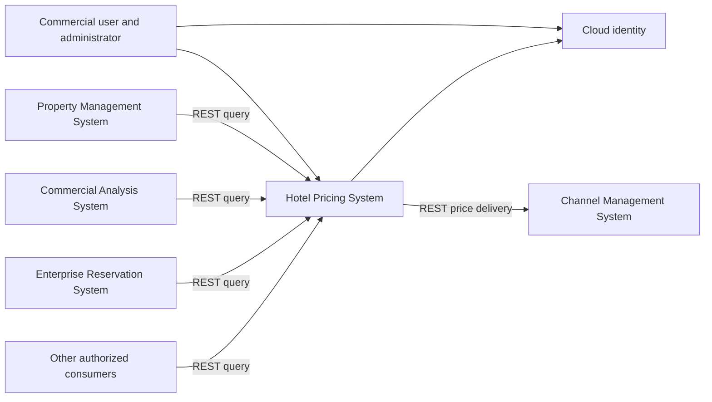

### 3.- Architectural drivers

Source: [architectural-drivers.md](../architectural-drivers.md). Current requirements override historical preparation commentary in that file.

| Story | Scope | Priority |
|---|---|---|
| HPS-1 | Provider login and hotel access | Supporting |
| HPS-2 | Simulate/change prices, derive rates, publish and deliver | Primary |
| HPS-3 | Browser/API price query | Primary |
| HPS-4 | Hotel, room and tax configuration | Primary |
| HPS-5 | Rate rules | Supporting |
| HPS-6 | User permissions | Supporting |

| Scenario | Target | Priority |
|---|---|---|
| QA-1 | Complete hotel/date prices queryable in less than 100 ms | High |
| QA-2 | 100% price changes published and received by CMS | High |
| QA-3 | Query availability 99.9% outside maintenance | High |
| QA-4 | 100k to 1m API queries/day with mean latency increase at most 20% | High |
| QA-5 | Provider authentication and authorized functions only | High |
| QA-6 | New query protocol without core changes | Medium |
| QA-7 | Environment movement without code changes | Medium |
| QA-8 | Collect 100% of publication performance/reliability measures | Medium |
| QA-9 | All elements independently integration-testable | Medium |

| Constraint | Response |
|---|---|
| CON-1 | Responsive browser UI across Windows/macOS/Linux and devices |
| CON-2 | Cloud resources and provider identity |
| CON-3 | Existing proprietary Git platform |
| CON-4 | Relative two-month MVP/six-month release |
| CON-5 | REST first, protocol adapters |
| CON-6 | Managed cloud services by capability, vendor not selected |

| Concern | Response |
|---|---|
| CRN-1 | Explicit containers and components |
| CRN-2 | Java and Angular |
| CRN-3 | Responsibility areas, named owners pending |
| CRN-4 | Versioned contracts and reviewable decisions |
| CRN-5 | Immutable artifact promotion and automated gates |

### 4.- Domain model

Business concepts are separate from deployment units. PriceSet, Publication, Delivery and ConfigurationActivation are design concepts introduced to express consistency and recovery.

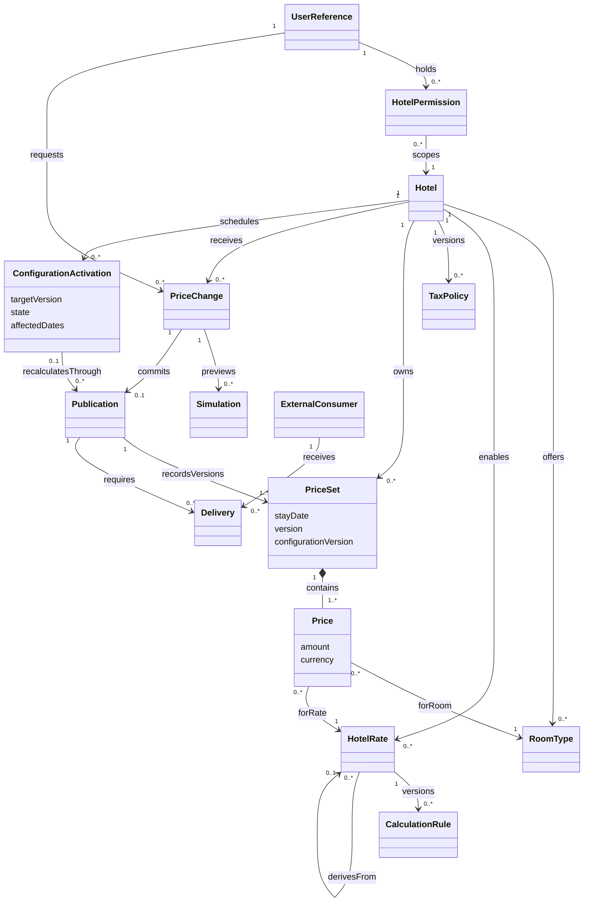

| Element | Responsibility/invariant |
|---|---|
| Hotel | Configuration and access boundary; incomplete hotels cannot publish |
| RoomType | Hotel-owned category; referenced history cannot be deleted |
| HotelRate | Base/fixed/derived; fixed has no parent, derived graph is acyclic |
| CalculationRule | Versioned restricted arithmetic; no arbitrary Java or remote calls |
| TaxPolicy | Versioned effective dates, inclusion and rounding policy |
| PriceSet | Complete hotel/date version with pinned configuration; atomic visibility |
| Price | Decimal amount and explicit currency for room/rate combination |
| PriceChange | One hotel's bounded date edits with expected versions and idempotency key |
| Simulation | Pure preview; no authoritative prices or delivery side effects |
| Publication | Immutable accepted payload, actor and timing identity |
| Delivery | Consumer/publication receipt, attempts and recovery state |
| ExternalConsumer | Contract and authorized scope; only CMS initially requires push |
| UserReference | Cloud subject, no HPS password |
| HotelPermission | Hotel and operation permissions for human or machine subject |
| ConfigurationActivation | Target version, affected dates, durable progress and explicit completion |

Currency, rounding, tax, effective-date and cross-hotel shared-rate semantics remain business decisions. All price dimensions must belong to the same hotel.

### 5.- Container diagram

Use a modular Java application, Angular UI and separately scaled background worker. Managed runtime and relational storage avoid introducing a distributed transaction across pricing modules during the MVP.

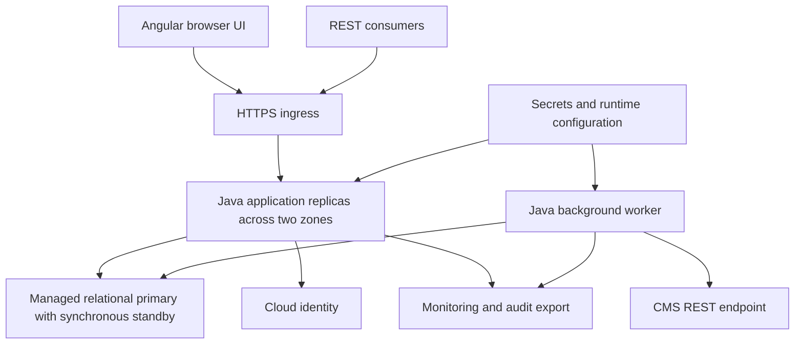

| Container | Responsibility |
|---|---|
| Angular UI | Provider login redirect, authorized views, simulation and query |
| HTTPS ingress | TLS, bounds, health routing; no business authorization ownership |
| Java application | Authentication backend, authorization, configuration, pricing and queries |
| Relational database | HPS-only configuration, prices, entitlements, sessions, publications and tasks |
| Background worker | Recoverable recalculation and external delivery, separate bounded pools |
| Monitoring | Dashboards/alerts; authoritative measurement records stay durable |
| Secrets/configuration | Runtime endpoints and credentials, outside artifacts |

HPS modules and worker share HPS-owned storage under explicit ownership; external systems have no SQL access. Modules are not separate services. A broker is deferred until measured throughput or additional consumers justify it.

### 6.- Component diagrams

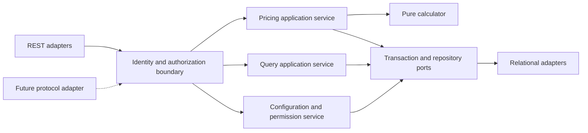

| Component | Responsibility |
|---|---|
| REST adapters | Transport mapping, bounds and correlation |
| Identity/authorization | Validate identity and current hotel/operation permissions |
| Pricing service/calculator | Orchestrate transactions; deterministic decimal calculations |
| Query service | Authorized complete versioned results |
| Configuration/permission service | Versioned setup, policy activation and entitlement audit |
| Ports/relational adapters | Protocol-neutral atomicity and persistence mapping |

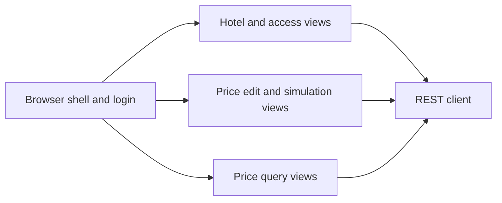

| Browser component | Responsibility |
|---|---|
| Shell/login | Provider redirect and secure server session |
| Hotel/access views | Scoped configuration and permissions |
| Pricing views | Preview, stale-input conflicts and commit result |
| Query views | Bounded filters and explicit versions |
| REST client | Correlation and error handling; never the sole access check |

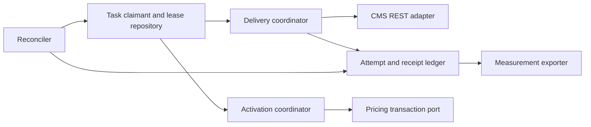

| Worker component | Responsibility |
|---|---|
| Claimant/lease repository | Expiring leases and fencing tokens; separate bounded delivery/recalculation pools |
| Delivery coordinator/CMS adapter | Per-hotel order, timeouts, retry/backoff and negotiated REST payload |
| Activation coordinator | One bounded date recalculation and durable task completion |
| Attempt/receipt ledger | Intent before send, observed outcome after send, unknown crash outcomes |
| Reconciler | Expired claims, blocked alerts, receipt lookup and authorized redrive |
| Measurement exporter | Unsampled resumable export with checkpoint/deduplication |

### 7.- Sequence diagrams

#### 7.1 Login and permissions - HPS-1, HPS-6, QA-5

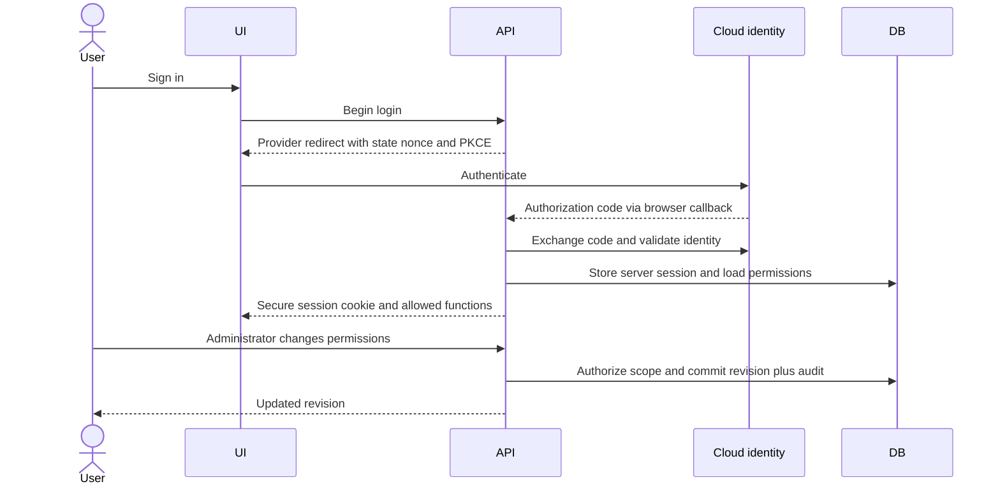

HPS never collects provider passwords. Validate issuer, audience, signature, expiry, state and nonce as applicable; use secure HttpOnly cookies and CSRF protection. Provider authentication follows [OpenID Connect Core](https://openid.net/specs/openid-connect-core-1_0.html). Hotel authorization remains an HPS responsibility.

#### 7.2 Configuration activation - HPS-4, HPS-5

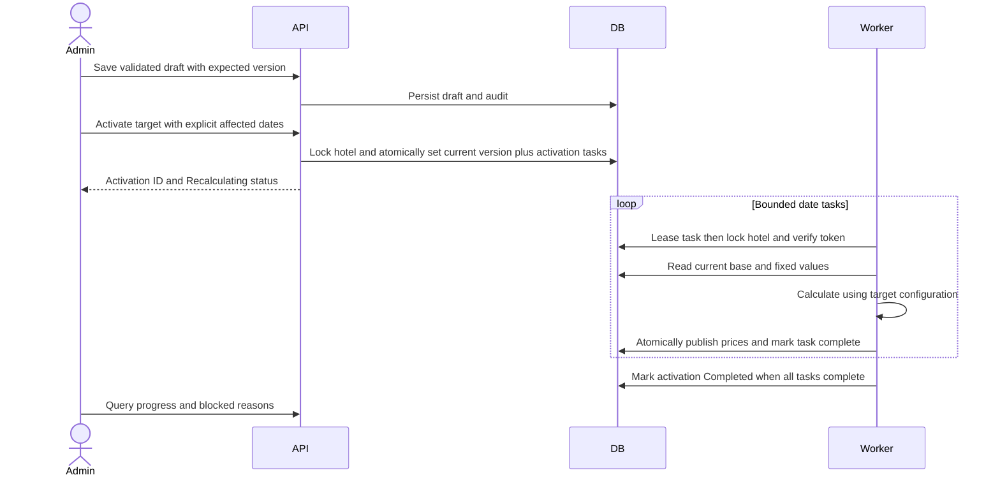

Draft -> Recalculating -> Completed is the normal lifecycle; failed validation before activation leaves Draft. An activated job may enter Blocked for a permanent domain error and resume after authorized repair. The configuration pointer, immutable affected-date task list, actor and audit commit atomically. A unique activation/date task key prevents duplicate completion. Workers persist leases, retry recoverable failures and verify lease tokens inside the price transaction; crash-before-commit rolls back, crash-after-commit replays the durable completion. No in-memory-only queue is authoritative.

Only one activation per hotel may be incomplete. Further draft editing is allowed, but another activation returns 409 until completion or repair. Once activated, cancel or rollback cannot simply change the pointer: finish/repair then issue a compensating activation. Missing dates/inputs and invalid graphs are checked before activation; unexpected per-date errors remain visible Blocked, with an alert and operator-owned redrive. Completion measures local recalculation; CMS receipt is separate.

During recalculation, queries return each date's last complete PriceSet with configurationVersion and activation status. Different dates may temporarily use different policy versions; no PriceSet mixes policies. This proposed cross-date consistency requires domain-owner agreement (A12). New user edits use the active configuration. If a date was already updated to the target version by a user, its task may atomically mark complete after verifying the full set; otherwise the worker recalculates from the latest base/fixed values and never overwrites them with a stale activation snapshot. Historical prices outside the explicitly approved affected-date scope remain unchanged.

#### 7.3 Simulation and atomic publication - HPS-2, HPS-3, QA-1, QA-2

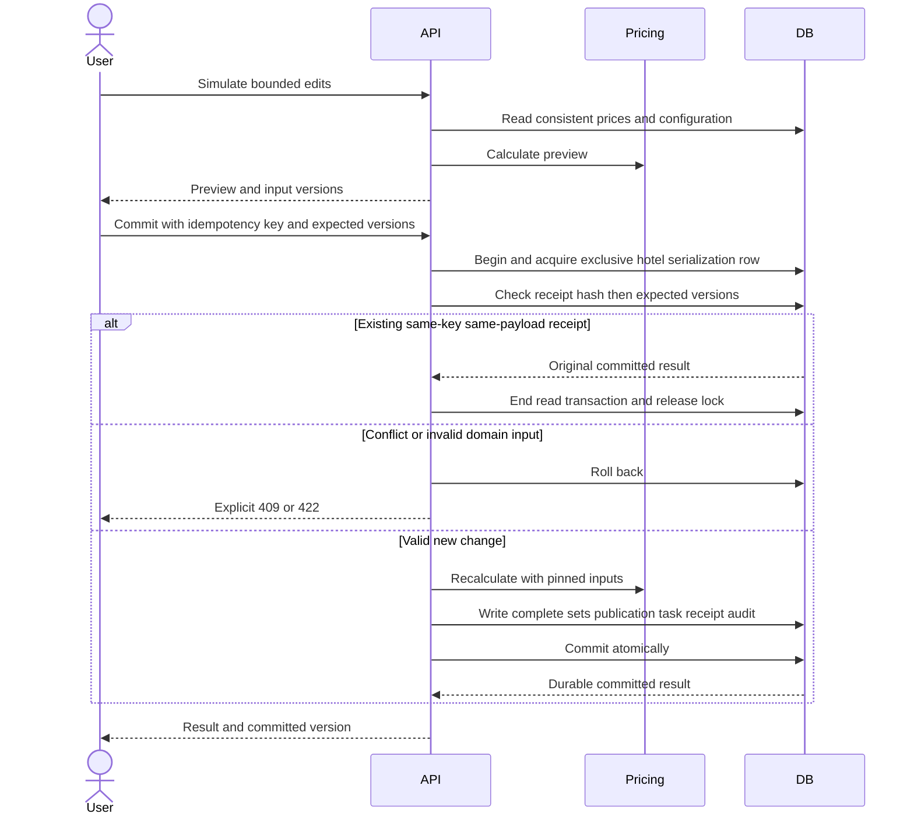

Acceptance means durable commit, not request arrival. Receipt, price sets, immutable publication payload and CMS delivery task share the transaction. A unique subject/hotel/idempotency key and request hash prevent duplicate commits after lost responses. A committed replay takes precedence over now-stale expected versions. Simulation never publishes. Query visibility ends at commit, independently of CMS receipt. This acceptance interpretation remains A2, not a rewrite of QA-2.

**Concurrency choice:** every price mutation, activation and configuration mutation takes the same exclusive hotel serialization row first, then affected date rows in ascending order. Different dates within one hotel therefore serialize intentionally; different hotels proceed independently. This simplifies policy/version and sequence consistency but creates a hot-hotel bottleneck. Read-only queries use consistent snapshots and do not take this mutation lock. Draft/activation transactions are short; recalculation takes one date per transaction, releases the hotel lock between tasks and yields to interactive traffic. Permission revision uses a separate transaction; in-flight authorization semantics are stated in 7.5. Lock acquisition waits are bounded and measured; rejected overload is recorded, never counted as successful performance. Replacing hotel serialization with shared configuration/exclusive date locking would require a new decision and ordering proof, not a hidden optimization. See [PostgreSQL explicit locking](https://www.postgresql.org/docs/current/explicit-locking.html) for the implementation family of lock semantics; the database vendor is not selected.

**QA-1 engineering target:** ingress/authorization 10 ms + input lookup/lock wait 15 ms + calculation 20 ms + atomic write/commit 30 ms = **75 ms**, with 15 ms contingency giving a **90 ms internal ceiling** and 10 ms headroom below the strict 100 ms requirement. These are allocations, not measurements or guarantees. Measure all ingress-to-commit time including scheduling/locks and all errors. Normal load, dimensions and statistical acceptance remain A1. Bounded multi-date interactive changes are all-or-nothing; separately specified activation/bulk work is not silently treated as the QA-1 single-date scenario. Reject oversize input explicitly, subject to agreed limits.

#### 7.4 Delivery and measurement - HPS-2, QA-2, QA-8

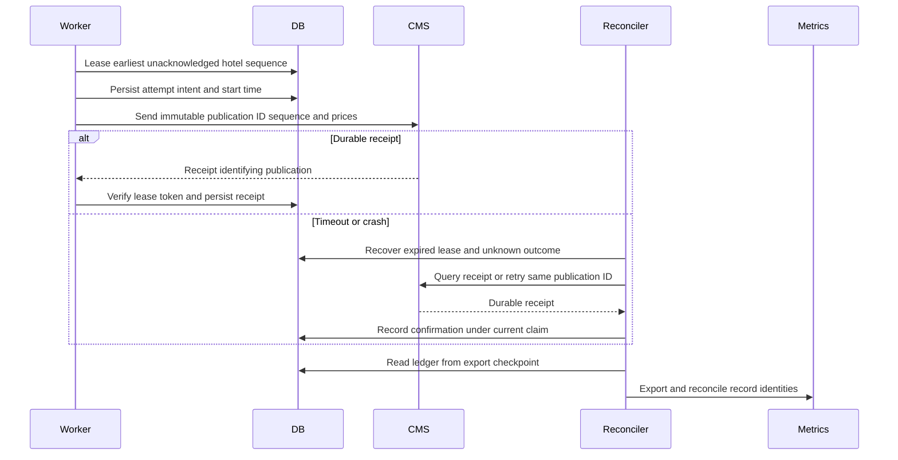

Delivery states are Pending, Leased, RetryDue, Blocked and Acknowledged. Send at least once; receiver deduplicates publication IDs and enforces hotel sequence. Local fencing cannot prevent an old network request from arriving late, so receiver sequencing is required. A 202 means poll unless the negotiated contract explicitly guarantees durable receipt. Never equate a generic HTTP success with proven receipt. Transient failures use bounded concurrent sends, exponential backoff/jitter and a circuit breaker. Authentication/domain failures retain work in Blocked; authorized repair/redrive is audited. One blocked event stalls its hotel, not others. No retry-count discard is allowed.

The immutable payload, task and local prices form a transactional outbox in the same database. [Transactional outbox guidance](https://docs.aws.amazon.com/prescriptive-guidance/latest/cloud-design-patterns/transactional-outbox.html) explains the dual-write and duplicate-handling concerns; this does not select AWS. If CMS lacks idempotency/sequence/receipt capabilities, negotiate a receiver adapter; sender logic alone cannot establish QA-2. Finite storage cannot support an unbounded outage: alarm on backlog, reserve headroom, bound admission before exhaustion and explicitly reject unpersistable changes. Outage, recovery rate and retention horizons remain A2/A3/A8.

Publication and attempt identities are durable and unsampled; export is resumable and reconciles ID sets, not just volatile counters. Persist request ingress identity with accepted publication. Measure elapsed time at the application boundary; a timestamp written before commit is not commit-completion evidence. A crash after commit but before timing persistence can make exact latency unknown. Use database-supported evidence if available, otherwise record unknown/bounded timing and keep QA-8 partial. Pre-persistence rejected/failed requests need a separate ingress accounting path whose completeness is also unproven. A monitoring outage does not erase the durable accepted-publication ledger.

#### 7.5 Query, failover and revocation - HPS-1, HPS-3, HPS-6, QA-3, QA-4, QA-5

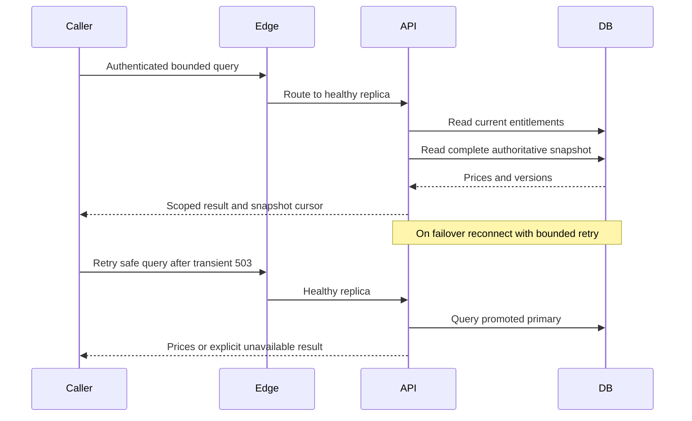

At least two application replicas span zones; a managed synchronous database standby provides failover, not routine reads. All authoritative queries initially use the primary. Readiness probes, graceful drain, bounded connection pools/timeouts and admission control protect queries. Reserve query concurrency/connections separately from writes and worker pools. CMS outage cannot occupy the query path, although all HPS workloads still share database capacity. Identity outage may block new login; valid sessions and cached valid keys may continue within validity, unknown keys fail closed. Database failover interrupts queries and counts against availability.

Use a single read snapshot for a response; multi-statement responses require repeatable snapshot semantics. Cross-page results are pinned to immutable PriceSet version references in a bounded-lived snapshot manifest. Store the manifest durably, enforce current authorization on every page and retain referenced price versions until cursor expiry. After expiry return an explicit restart-required error, never silently mix current rows. Cursor lifetime/storage caps are A13; capacity exhaustion rejects creation explicitly. Publication IDs are global; per-hotel publication sequence allocation occurs under the same exclusive hotel mutation lock and commits with its payload/task. Replays do not allocate another sequence.

Server authorization checks current entitlements for each protected request, including machine tokens with explicit hotel/operation grants. Permission changes atomically write revision and audit after validating administrator scope. Revocation affects authorization checks after the change commits; already authorized in-flight work may finish. This boundary requires A7 agreement. Browser function filtering supports usability but is never enforcement. No identity SDK or transport class enters the domain core.

100k/day averages 1.16 queries/s; 1m/day averages 11.57. Provisionally test a 10-times-average peak, approximately 116 queries/s at high volume, until actual peak/query mix is agreed. QA-4 explicitly requires mean latency at high volume <=1.2 times baseline; its wording is resolved. Compare identical query shapes, data/hotel skew, warm-up and error accounting, measure achieved throughput and tails, and reject apparent improvement caused by dropped traffic. Index hotel/date/room/rate, bound requests and scale API replicas on saturation/latency. API scaling is not proof of database capacity; hotel-lock contention must be tested separately.

For a provisional 30-day period, 99.9% corresponds to 43.2 minutes unavailable before exclusions. A4 must define time-based eligibility and maintenance windows; request success rate complements rather than replaces the uptime SLI. Include dependency/failover/overload failure, show excluded maintenance separately. Backup/restore and regional recovery targets remain unresolved.

#### 7.6 Protocol extension and independent testing - QA-6, QA-9

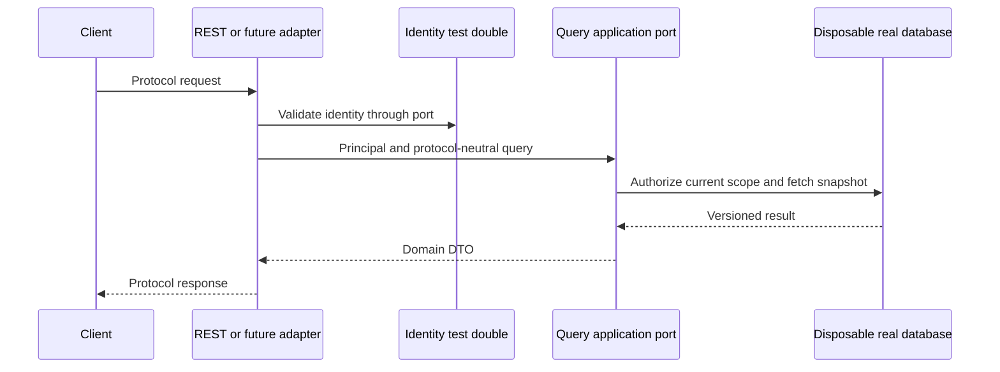

Domain/application types contain no REST, gRPC, SQL or provider SDK types. A new protocol changes adapters and composition wiring without core changes. Real disposable storage tests atomicity; programmable identity/CMS doubles test external failure independently. Staging also uses all external test systems to detect mock drift. The validation inventory includes worker activation, infrastructure and migration, not just application classes.

#### 7.7 Environment promotion - QA-7, CON-3, CRN-5

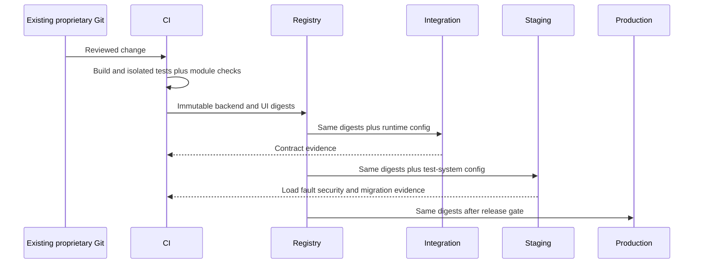

Development uses local disposable dependencies; integration substitutes unavailable external systems; staging connects all test systems; production uses live endpoints. Angular loads runtime configuration rather than requiring per-environment compilation. Secrets stay outside artifacts. Expand/contract schema changes permit old/new binaries to overlap; rollback application digests while retaining compatible schema, and delay destructive cleanup until the rollback window closes. CI checks module imports, schema compatibility and contracts; dashboards alert on latency, failed/unknown publications, activation age, delivery backlog and storage headroom.

#### 7.8 Replacement-system cutover - HPS-2, QA-2, CRN-4

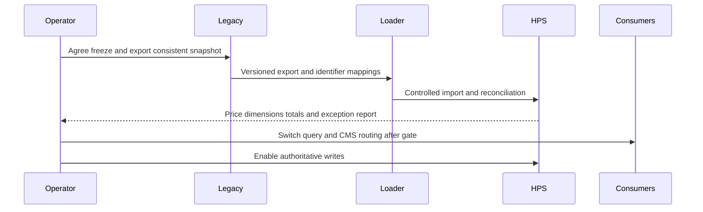

Rehearse snapshot import and full dimension/count/amount reconciliation in staging; golden cases validate recomputation rather than assuming legacy outputs are correct. Freeze legacy edits for the agreed final window, import/reconcile final changes, drain or transfer outstanding legacy CMS work with deduplication/watermark agreement, then switch consumers/CMS routing and enable HPS writes. There is only one authoritative writer. Before new writes routing can return to legacy; afterwards rollback requires reverse reconciliation and receipt/delivery deduplication, never a blind return to stale data. Bulk cutover timing is separate from interactive QA-1.

For an activated configuration whose immutable target cannot be repaired by valid input correction or implementation repair, routine redrive is insufficient. Keep it Blocked with current/previous price versions visible; do not silently mutate target/scope or unlock another activation. An exceptional compensating/replacement transition and its effects on already published prices require explicit domain approval before implementation acceptance (A12). This remaining policy is why HPS-4/5 stay partially satisfied.

### 8.- Interfaces

| Interface | Contract |
|---|---|
| Login callback/session | Validated provider identity, secure server session; invalid identity rejected |
| Configuration resources | Scoped administrator, expected version and audit; preserve referenced history |
| Permission resource | Subject, hotel, allowed operations and expected revision; no grants outside administrator scope |
| POST /v1/hotels/{hotelId}/price-simulations | Bounded date edits; returns preview and configuration/price versions; no publication |
| POST /v1/hotels/{hotelId}/price-changes | Idempotency-Key, expected versions and edits; 201 durable result, replay original result, 409 conflict, 413 oversized |
| GET /v1/hotels/{hotelId}/prices | Bounded dates/filters, version cursor; complete snapshot with decimal-string amounts, currency, configurationVersion and activation status; absent price is not zero |
| POST /v1/hotels/{hotelId}/configuration-activations | Draft target, expected current version, explicit affected dates and idempotency key; 202 durable job, 409 competing activation |
| GET /v1/hotels/{hotelId}/configuration-activations/{id} | Scope-checked progress, completed/blocked date counts and repair reason |
| Activation redrive command | Authorized administrator, expected activation revision and audit; immutable target and scope; retry only unfinished tasks |
| Pricing transaction port | Atomic prices/publication/task/receipt/audit or no accepted change; activation task completion shares its recalculation transaction |
| CMS publication contract | Schema version, publication ID, hotel sequence, immutable prices, currency, configuration versions and checksum; receiver deduplicates, orders and returns durable receipt |
| GET /v1/publications/{id} | Authorized owning-hotel publication plus local acceptance and CMS receipt status |
| Publication measurement | Ingress identity, publication, commit outcome/timing certainty, attempt/receipt times; durable resumable export |
| PriceQuery application port | Principal, hotel, bounded filters and snapshot reference; protocol-neutral result; current authorization within application boundary |

All public interfaces use TLS, authenticated principals and current hotel/operation permissions. Return 401 invalid identity, 403 forbidden scope, 409 version conflict, 422 domain invalidity, 429 overload and 503 temporary dependency failure. Error bodies must not expose another hotel's data.

Amounts are decimal strings with explicit currency; stay dates are hotel-local dates and audit instants UTC. Currency conversion is outside supplied scope. OpenAPI/schema definitions and partner negotiation are implementation deliverables. Retain idempotency receipts, immutable publications, attempts and reconciliation watermarks for the agreed replay/recovery horizon; archive before pruning. Snapshot references prevent referenced version pruning until expiry. Do not confuse command replay retention with browser cursor lifetime.

### 9.- Design decisions

| ID / Drivers | Decision | Rationale | Discarded alternative |
|---|---|---|---|
| D1 / CRN-1/2, CON-1/4/6 | Angular, modular Java application and separate worker on managed cloud | Known stack and small deployment surface | Per-domain microservices and self-managed cluster without demonstrated need |
| D2 / HPS-1/6, QA-5, CON-2 | Provider login and server hotel entitlements | Separate credentials from business authorization | Local passwords or UI-only checks |
| D11 / CRN-3/4, CON-4 | Responsibility owners, contract review and staged evidence | Expose staffing and delivery uncertainty | Assumed team size and unqualified deadline commitment |
| D3 / HPS-2/4/5, QA-1 | Pure versioned decimal calculator and bounded requests | Preview/commit parity and predictable work | Remote rules engine or unbounded executable rules |
| D4 / QA-1/2, CRN-4 | Atomic publication, receipt and delivery task | No accepted local update without recoverable delivery | DB/network dual writes |
| D5 / HPS-3, QA-1/4 | Authoritative complete PriceSet queries | Immediate committed visibility | Undefined stale caches/replicas |
| D13 / HPS-2/4/5, QA-1/2 | Exclusive per-hotel mutation serialization | Simple policy and publication ordering | Fine-grained locks before measured need and consistency proof |
| D14 / HPS-4/5, QA-2 | Durable bounded activation tasks with explicit cross-date transition | Recoverable recalculation without stale input overwrite | Fire-and-forget recalculation or one unbounded hotel transaction |
| D6 / QA-2, CON-5 | Leased REST delivery with receiver receipt, deduplication and sequencing | Isolate remote failure and recover ambiguity | Synchronous CMS transaction or exactly-once HTTP claim |
| D7 / QA-8 | Durable unsampled ledger and checkpointed export | Recover accounting after exporter outage | Sampled traces as sole completeness evidence |
| D8 / QA-3/4, CON-2/6 | Multi-zone replicas, synchronous standby and query reservations | Limit node failure and resource interference | Single-zone or premature multi-region active-active |
| D9 / QA-6/9, CON-5 | Protocol-neutral ports and replaceable outbound adapters | Extension and independent integration tests | HTTP/SDK dependencies in core |
| D10 / QA-7, CON-3, CRN-5 | Build once, runtime config and compatible migrations | Reproducible promotion/rollback | Per-environment rebuild or breaking simultaneous migration |
| D12 / HPS-2, QA-2, CRN-4 | Reconciled import and controlled authority switch | Prevent conflicting writers and lost delivery history | Uncoordinated dual writes |

D1-D14 represent design coverage, not test results. D3/D4/D6/D7/D8/D13/D14 depend on acceptance definitions and evidence detailed in validation-plan.md. No procurement, deployment or external messaging is authorized by these artifacts.
