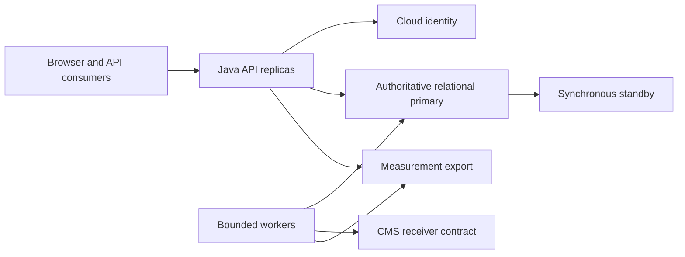

# Architecture Evaluation Result — Hotel Pricing System

## 1. Introduction

ATAM evaluation started 2026-10-18, resumed 2026-10-19 and finalized 2026-10-20, Asia/Seoul. Steps 1-9 cover both phases, five independent simulated stakeholder roles, all nine initial and ten additional scenarios. This report evaluates the unchanged 2026-10-18 ADD baseline. [Preparation](preparation.md) records Steps 1-3, the complete baseline hashes, method, participation and scoring rules. [Participation](participation.md) preserves actual agent exchanges and ballots. All findings are document-based; no load, fault, security, integration or implementation test was executed.

Business objective: replace a legacy pricing system for approximately 300 hotels, avoid revenue loss, publish correct prices promptly, reliably deliver to CMS, and isolate failures and change. HPS-2/3/4 and QA-1..5 are primary. HPS-1..6, QA-1..9, CON-1..6 and CRN-1..5 remain in scope. Two-month MVP and six-month release are constraints, not validated commitments. The five simulated stakeholders are revenue/pricing, CMS integration, SRE operations, security/identity and engineering/QA delivery. Their votes are distinct from actual customer approval.

## 2. Architecture Presentation

### Step 4: Identified approaches

| Approach | Baseline decisions and location | Structures and interactions |
|---|---|---|
| AP1 Modular application and managed cloud | D1/D11; architecture 5/6 | Angular browser, Java API replicas, separate worker, HPS-owned relational storage; responsibility areas rather than assumed staffing |
| AP2 Identity and server authorization | D2; 7.1/7.5 | Cloud login, server sessions and current hotel/operation grants for every human/machine request |
| AP3 Bounded deterministic pricing | D3/D13; 7.2/7.3 | Pure versioned decimal calculator; exclusive hotel mutation lock; expected versions and idempotency receipts |
| AP4 Atomic publication and durable activation | D4/D14; 7.2/7.3 | PriceSet, publication, task and receipt share commit; one-date activation transactions with durable leases/progress |
| AP5 Authoritative snapshot queries | D5; 7.5 | Indexed primary reads, complete PriceSets and durable bounded-lived snapshot manifests |
| AP6 Recoverable REST delivery | D6; 7.4 | Transactional outbox, at-least-once sends, per-hotel order, receiver deduplication/sequence/durable receipt, blocked/redrive states |
| AP7 Durable measurement | D7; 7.4 | Unsampled publication/attempt ledger, export checkpoints and identity-set reconciliation |
| AP8 Availability/resource isolation | D8; 5/7.5 | Multi-zone API, synchronous standby, bounded pools, reserved query resources; primary remains shared bottleneck |
| AP9 Ports and adapters | D9; 6/7.6 | Protocol-neutral core and replaceable identity/CMS adapters; real disposable database in isolated tests |
| AP10 Promotion and replacement | D10/D12; 7.7/7.8 | Same artifact digests, runtime configuration, compatible migrations; reconciled legacy import and single authority switch |

This inventory captures approaches before scenario-specific analysis. Detailed diagrams remain in [architecture](../design/architecture.md); the following evaluation diagram identifies shared contention and external contract boundaries.

## 3. Quality Attribute Utility Tree

### Step 5: Initial utility tree

The utility root is business-safe, timely, available pricing. Attribute/refinement/scenario columns are its branches and leaves. The evaluator assigns provisional numeric scores using preparation's anchors and original High/Medium priorities. Importance is business consequence; difficulty is unresolved realization effort/uncertainty. These are ordinal judgements, not measured probabilities. All nine leaves are analyzed regardless of rank.

| Quality Attribute | Refinement | Scenario | Importance | Difficulty |
|---|---|---|---:|---:|
| Performance | Local complete publication | QA-1: one hotel/date base-rate edit makes all rates/rooms queryable in <100 ms at normal load | 100 | 90 |
| Reliability | Accepted change and CMS receipt | QA-2: all price changes publish and are received by CMS | 100 | 100 |
| Availability | Query continuity | QA-3: 99.9% uptime outside maintenance | 100 | 80 |
| Scalability | Tenfold read workload | QA-4: 100k to 1m queries/day, mean latency increase <=20% | 90 | 80 |
| Security | Authorized identity and functions | QA-5: provider validates login and only authorized operations/hotels are accessible | 100 | 60 |
| Modifiability | Additional transport | QA-6: non-REST query endpoint without core changes | 60 | 50 |
| Deployability | Environment portability | QA-7: promote nonproduction environments without code changes | 60 | 50 |
| Monitorability | Complete publication accounting | QA-8: collect 100% of publication performance/reliability measures | 70 | 90 |
| Testability | Independence from external business systems | QA-9: 100% of elements support independent integration testing | 70 | 60 |

QA-8 difficulty is raised above its original Medium because crash-window exact timing and ingress completeness remain unresolved. QA-2 has the highest difficulty because sender tactics cannot establish receiver guarantees. QA-1 includes hotel-lock waits, so its 90 ms allocation is not a demonstrated bound.

### Step 7: Stakeholder brainstorming and public vote

Five roles independently proposed two scenarios each and reviewed the shared Phase 1 findings and [candidate pool](scenario-pool.md). All agreed that the ten concerns were distinct: related cutover scenarios S-04/S-10 test different authority and deployment behaviors. Use-case, growth and exploratory scenarios are represented. [Participation](participation.md) records cross-role challenges, consolidation acceptance and public ballots. Each role cast five distinct votes; total 25. Neither evaluator nor designer voted.

| ID | Scenario | Quality Attributes | Votes |
|---|---|---|---:|
| S-02 | Recover irreparable policy activation at portfolio scale | Reliability, availability, monitorability, correctness | 4 |
| S-03 | Recover lost CMS receipts with duplicate and late requests | Reliability, monitorability | 4 |
| S-04 | Fence delayed legacy requests during cutover and rollback | Reliability, availability, monitorability | 4 |
| S-05 | Sustain query growth with concentrated hotel mutations | Performance, scalability, availability, monitorability | 3 |
| S-06 | Recover DB failure during telemetry/storage pressure | Reliability, availability, monitorability | 2 |
| S-07 | Enforce revoked scope across cursors and replays | Security, monitorability | 2 |
| S-08 | Handle identity key rotation during provider outage | Security, availability, monitorability, testability | 2 |
| S-09 | Extend protocol with trustworthy independent tests | Modifiability, security, testability | 2 |
| S-01 | Confirm changed policy and replay lost response | Performance, reliability, correctness | 1 |
| S-10 | Deliver and roll back after accepted writes | Deployability, reliability, testability, buildability | 1 |

Rank uses votes descending then numeric ID ascending. **S-02, S-03, S-04, S-05 and S-06** become new leaves. S-06 wins the four-way two-vote tie by ID; no greater severity is inferred. All ten are analyzed in Step 8. Votes do not remove original requirements or accept risks.

### Final utility tree and Importance/Difficulty prioritization

The tree contains exactly 14 leaves: nine original plus five selected new scenarios. Sum = Importance + Difficulty; table ordered by Sum descending then original/new numeric ID. This analytical score order does not override ballot selection. QA-8 Importance changes 70 to 80 after SH1's reconciliation concern supported by SH3/SH4/SH5; SH2's qualification is retained: CMS receipt evidence remains a QA-2 obligation. QA-5 Difficulty changes 60 to 70 after SH4 identifies key/session/in-flight uncertainties. Initial scores above remain as history. New scores are evaluator judgements using the same anchors: S-02/03/04 carry unresolved critical policy/receiver authority boundaries; S-05/06 combine demanding shared-resource and failure conditions. They are not measured effort or stakeholder vote counts.

| Quality Attribute | Refinement | Scenario | Importance | Difficulty | Sum |
|---|---|---|---:|---:|---:|
| Reliability | Complete local/external publication | QA-2 | 100 | 100 | 200 |
| Reliability / correctness | Exceptional activation recovery | S-02 | 100 | 100 | 200 |
| Reliability | Durable CMS receipt under ambiguity | S-03 | 100 | 100 | 200 |
| Reliability / availability | Cross-generation price authority | S-04 | 100 | 100 | 200 |
| Performance | Complete publication latency | QA-1 | 100 | 90 | 190 |
| Availability / reliability | Failover with retention pressure | S-06 | 100 | 90 | 190 |
| Availability | Query continuity | QA-3 | 100 | 80 | 180 |
| Scalability / performance | Hot-hotel and mixed workload | S-05 | 90 | 90 | 180 |
| Scalability | Tenfold read volume | QA-4 | 90 | 80 | 170 |
| Security | Current scopes and identity trust | QA-5 | 100 | 70 | 170 |
| Monitorability | Complete publication measurements | QA-8 | 80 | 90 | 170 |
| Testability | External-system-independent harness | QA-9 | 70 | 60 | 130 |
| Modifiability | Additional query transport | QA-6 | 60 | 50 | 110 |
| Deployability | Runtime environment configuration | QA-7 | 60 | 50 | 110 |

## 4. Architectural Approaches Analysis

### Step 6: Every initial scenario

Evidence references refer to the frozen architecture and validation plan. R, S, T and N identifiers are defined in section 5. Nonrisk is conditional design adequacy for its narrow mechanism; none is a passed implementation test. Each scenario includes its stimulus, expected response, response measure, reasoning, evidence gap and architectural diagram reference.

### QA-1 — Local publication latency

| Scenario | QA-1 |
|---|---|
| Attribute(s) | Performance, consistency |
| Environment | Normal mixed workload; maximum supported room/rate dimensions and normal load undefined, A1 |
| Stimulus | Authorized user changes one hotel's base rate for one date |
| Response | Recalculate all dependent rates/rooms and atomically expose complete PriceSets |
| Response measure | Strict <100 ms; proposed ingress-to-commit clock requires agreement; 90 ms internal ceiling is an allocation only |
| Reasoning | Pure bounded computation and local commit avoid CMS latency, but exclusive hotel lock queues all mutations, including other dates and activation; synchronous storage adds latency |
| Evidence / assumptions | Architecture 7.3; validation QA-1 experiment not run. A1/A6 pending; reject-based apparent speedup is not success |
| Architecture diagram | Architecture 7.3 simulation/publication sequence and section 6 application diagram |

| Architectural Decisions | Risk | Sensitivity | Tradeoff | Nonrisk |
|---|---|---|---|---|
| D3/D4/D13: local transaction with hotel serialization | R1: lock wait/dimension/load uncertainty can exceed 100 ms | S1: lock hold/queue time, calculator graph and commit latency | T1: simple strong ordering versus parallel mutation throughput | N1: CMS is outside query-ready commit path |

### QA-2 — Complete publication and CMS receipt

| Scenario | QA-2 |
|---|---|
| Attribute(s) | Reliability, integrity |
| Environment | Multiple edits, crashes, lost acknowledgements and recoverable CMS outage |
| Stimulus | User performs successive hotel price changes |
| Response | Every accepted change remains queryable and receives a durable CMS receipt without duplicate logical application or stale overwrite |
| Response measure | Original 100% requirement; accepted=committed/eventual receipt are A2 proposals; outage duration and recovery deadline unspecified |
| Reasoning | Atomic outbox removes local dual-write gap. Expiring claims and ID replay recover sender crashes; only receiver deduplication/order/receipt handles late requests and unknown outcomes. Finite storage and blocked hotel order limit progress |
| Evidence / assumptions | Architecture 7.3/7.4/7.8; A2/A3/A10/A13 unresolved; no CMS contract or fault results |
| Architecture diagram | Architecture 7.4 delivery and 7.8 cutover sequences |

| Architectural Decisions | Risk | Sensitivity | Tradeoff | Nonrisk |
|---|---|---|---|---|
| D4/D6/D12: outbox, receipt and single-writer migration | R2: receiver capabilities unconfirmed; R3: backlog/retention limits; R10: cutover reconciliation unspecified | S2: receiver ordering/dedup horizon; S3: drain rate/storage; S8: cutover watermarks | T2: ordered no-discard delivery versus head-of-line blocking and storage cost | N2: atomic task creation prevents accepted local prices without delivery obligation |

### QA-3 — Query availability

| Scenario | QA-3 |
|---|---|
| Attribute(s) | Availability, resilience |
| Environment | Eligible service time, dependency/node/zone failure and overload |
| Stimulus | Client queries while a component fails |
| Response | Healthy replicas serve authorized complete prices; bounded failure/retry and recovery are visible |
| Response measure | 99.9% outside agreed maintenance; provisional 30 days allows 43.2 minutes, not an approved SLA period; RTO/RPO open |
| Reasoning | Multiple API zones remove a single API-node dependency, but database failover, identity login and shared primary exhaustion remain failure paths |
| Evidence / assumptions | Architecture 5/7.5; A4 unresolved; no selected provider durability guarantee or failover/restore measurements |
| Architecture diagram | Architecture 5 container and 7.5 query/failover sequences |

| Architectural Decisions | Risk | Sensitivity | Tradeoff | Nonrisk |
|---|---|---|---|---|
| D8/D5/D2: zones, synchronous standby and authoritative primary | R4: recovery/accounting undefined; R5: shared DB saturation | S4: failover duration/pool reservations; S5: identity/key validity | T3: durability/immediate consistency versus failover latency and cost | N3: CMS is absent from the synchronous read path; not proof of DB isolation |

### QA-4 — Read scaling

| Scenario | QA-4 |
|---|---|
| Attribute(s) | Scalability, performance |
| Environment | Same query/data mix at 100k and 1m daily requests, plus agreed peaks |
| Stimulus | API demand increases tenfold |
| Response | Sustain achieved traffic while bounding mean latency increase |
| Response measure | Mean high-load latency <=1.2 times baseline; report errors/throughput and tail latency together |
| Reasoning | Indexed bounded reads and API scaling help, but primary entitlement reads, snapshots, publication writes and worker polling share resources. 116 queries/s is provisional sizing, not a demand ceiling |
| Evidence / assumptions | Architecture 7.5; A5/A13 unresolved; no load profile or capacity evidence |
| Architecture diagram | Architecture 5 and 7.5 |

| Architectural Decisions | Risk | Sensitivity | Tradeoff | Nonrisk |
|---|---|---|---|---|
| D5/D8: primary snapshots, indexes and resource reservations | R5: DB bottleneck; R3: cursor/version retention pressure | S4: pools/indexes/query skew; S6: cursor lifetime and retained versions | T4: current coherent reads versus scalable stale replicas; T5: stable pagination versus retention cost | N4: complete snapshot/expiry contract avoids silent cross-page version mixing |

### QA-5 — Identity and authorization

| Scenario | QA-5 |
|---|---|
| Attribute(s) | Security, confidentiality |
| Environment | Browser login and human/machine protected requests, including concurrent permission changes |
| Stimulus | User logs in and attempts scoped functions |
| Response | Provider validates identity; server permits only current hotel/operation grants and scopes administrative changes |
| Response measure | No unauthorized operation or hotel disclosure; explicit 401/403; post-commit authorization sees revocation, while already-authorized work may finish under A7 |
| Reasoning | Current server grants avoid UI-only enforcement; session/CSRF and identity validation are specified. In-flight boundary and privileged recovery permissions still need agreement |
| Evidence / assumptions | Architecture 7.1/7.5/8; A7 pending; negative/token/revocation tests not run |
| Architecture diagram | Architecture 7.1 login and 7.5 query sequences |

| Architectural Decisions | Risk | Sensitivity | Tradeoff | Nonrisk |
|---|---|---|---|---|
| D2: provider identity plus per-request current grants | R6: revocation/admin/machine scope acceptance unspecified | S5: grant-check time, session/key validity and in-flight duration | T6: current authorization versus DB cost and availability dependency | N5: server scope checks cover UI and machine access; passwords remain provider-owned |

### QA-6 — New query protocol

| Scenario | QA-6 |
|---|---|
| Attribute(s) | Modifiability, security |
| Environment | Existing REST query service, development change |
| Stimulus | Add a non-REST query endpoint |
| Response | Add transport mapping and composition wiring while preserving query/auth semantics |
| Response measure | Core source unchanged; equivalent validation, scope and snapshot results |
| Reasoning | Protocol-neutral ports separate transports; only a concrete second adapter can expose accidental coupling |
| Evidence / assumptions | Architecture 6/7.6; no implementation or alternative-adapter diff exists |
| Architecture diagram | Architecture 6 component and 7.6 extension sequence |

| Architectural Decisions | Risk | Sensitivity | Tradeoff | Nonrisk |
|---|---|---|---|---|
| D9: protocol-neutral core | R7: boundary drift or omitted auth in added adapter | S7: transport types entering ports and contract parity | T7: adapter indirection versus extension/test independence | N6: specified principal-aware core owns authorization rather than transport alone |

### QA-7 — Environment promotion

| Scenario | QA-7 |
|---|---|
| Attribute(s) | Deployability, recoverability |
| Environment | Integration-to-staging promotion with external endpoints/secrets differing |
| Stimulus | Move application to another nonproduction environment |
| Response | Promote identical UI/backend artifacts with validated runtime configuration |
| Response measure | Same digests and no source modification; migrations preserve declared overlap/rollback window |
| Reasoning | Runtime Angular configuration addresses common build-time coupling; schema compatibility remains a separate release responsibility |
| Evidence / assumptions | Architecture 7.7; no pipeline promotion, config validation or rollback execution |
| Architecture diagram | Architecture 7.7 environment sequence |

| Architectural Decisions | Risk | Sensitivity | Tradeoff | Nonrisk |
|---|---|---|---|---|
| D10: immutable digests and expand/contract schema | R8: incompatible schema or config can defeat safe promotion/rollback | S7: configuration schema and compatibility window | T8: reversible overlap versus migration complexity and delayed cleanup | N7: backend/UI runtime configuration gives a coherent no-code-change mechanism |

### QA-8 — Complete measurements

| Scenario | QA-8 |
|---|---|
| Attribute(s) | Monitorability, reliability |
| Environment | Publication and retry activity during exporter/API crashes |
| Stimulus | Operator requests publication performance and reliability measures |
| Response | Export all durable identities/outcomes and label unknown timing rather than fabricate it |
| Response measure | Original 100% measure availability; identity completeness does not establish 100% exact latency completeness |
| Reasoning | Ledger/checkpoints recover exporter outages. Commit then crash before timing persistence can leave accepted publication without exact elapsed time; pre-persistence failures have a separate unproven accounting path |
| Evidence / assumptions | Architecture 7.4; A8/A13 unresolved; no completeness reconciliation results |
| Architecture diagram | Architecture 6 worker and 7.4 delivery/measurement sequence |

| Architectural Decisions | Risk | Sensitivity | Tradeoff | Nonrisk |
|---|---|---|---|---|
| D7/D4: durable unsampled accounting | R9: exact timing/ingress completeness not satisfied by IDs; R3: retention pressure | S9: commit-to-timing crash window, export watermark and retention | T9: exhaustive durable telemetry versus write/storage overhead and QA-1 pressure | N8: exporter outage alone cannot erase durably accepted publication identities |

### QA-9 — Independent integration tests

| Scenario | QA-9 |
|---|---|
| Attribute(s) | Testability, reliability |
| Environment | Integration harness without live CMS/identity/enterprise business systems |
| Stimulus | Test each system element and its integration behavior |
| Response | Substitute external adapters; use real disposable storage for transactional/locking semantics |
| Response measure | Every element in validation inventory independently testable; actual external staging checks additionally detect double drift |
| Reasoning | Inventory covers UI, core, worker, infrastructure and migration. Mocks alone cannot prove partner behavior or selected cloud durability |
| Evidence / assumptions | Architecture 7.6; validation inventory; A11 pending; harnesses not implemented/run |
| Architecture diagram | Architecture 7.6 testing sequence |

| Architectural Decisions | Risk | Sensitivity | Tradeoff | Nonrisk |
|---|---|---|---|---|
| D9/D10: ports, real storage and test doubles | R7: double/contract drift; R11: evidence effort exceeds capacity | S7: semantic fidelity/coverage; S10: staff and external test access | T7: isolated repeatability versus partner realism and maintenance effort | N9: planned real-store harness avoids mocking away transaction/lease behavior |

### Step 8: Phase 2 analysis

The [complete scenario pool](scenario-pool.md) records ten candidates and provenance. Analysis below covers every candidate independently of selection, including the five unselected scenarios S-01/07/08/09/10. Proposed numeric stress/recovery values are hypotheses awaiting agreement; they do not amend original requirements. Initial scenarios are also revalidated below. No risk is closed by a vote.

### S-01 — Stale preview and lost-response replay

| Scenario | S-01, SH1 use case |
|---|---|
| Attribute(s) | Performance, reliability, monetary correctness |
| Environment | Normal load with overlapping policy activation |
| Stimulus | Preview, activate different policy, submit stale version, refresh/commit and retry after lost response |
| Response | Reject stale new command; fresh calculation uses approved policy; authorized replay returns original durable result |
| Response measure | Zero stale commits/incomplete sets, one logical publication per key, A6 golden amounts; QA-1 only under agreed A1 |
| Reasoning | Expected versions, pure calculation, immutable receipt and atomic commit fit this sequence; no monetary policy or replay-expiry implementation is evidenced |
| Evidence / assumptions | Architecture 7.2/7.3/8; A1/A2/A6/A12/A13 unresolved; no executable tests |
| Architecture diagram | Architecture 7.3; authorization boundary in section 6 |

| Architectural Decisions | Risk | Sensitivity | Tradeoff | Nonrisk |
|---|---|---|---|---|
| D2/3/4/13/14 | R1/R3/R6/R12: timing, expired replay, authorization and policy gaps | S1/S5/S6: lock, current grants and replay horizon | T1/T6: consistency/security versus work latency | N2/N5: atomic receipt and current authorization provide a coherent basis, subject to tests |

Required action: domain owner approves monetary examples; engineering/QA proves stale-first-command versus committed replay behavior, including expired keys and revocation, before pricing acceptance. Architecture is conditionally adequate; golden policy and retention cannot be inferred from decimal representation.

### S-02 — Irreparable activation at scale

| Scenario | S-02, SH1 exploratory/growth |
|---|---|
| Attribute(s) | Correctness, reliability, availability, monitorability |
| Environment | Proposed 300 hotels x 365 dates with concurrent sales |
| Stimulus | Immutable policy target becomes irreparable after partial publication |
| Response | Trace versions/progress, preserve latest edits and converge via approved compensation/replacement |
| Response measure | Zero false completion/invalid sets/overwritten edits; proposed alarm <=60 seconds and local/CMS convergence <=30 minutes after approval |
| Reasoning | Durable per-date progress survives crashes, but no authorized state transition escapes an unrecoverable target. Routine redrive is not compensation and another activation is blocked |
| Evidence / assumptions | Architecture 7.2/7.8; A6/A12, CMS and telemetry limits open; proposed time bound unmeasured |
| Architecture diagram | Architecture 7.2 activation sequence |

| Architectural Decisions | Risk | Sensitivity | Tradeoff | Nonrisk |
|---|---|---|---|---|
| D3/4/6/13/14 | R12: missing exceptional state transition; R1/R2/R3: convergence capacity | S1/S2/S3: per-hotel throughput, receiver and backlog | T1/T2: bounded recoverable work versus whole-hotel convergence speed | N2: task completion shares its publication transaction; this does not solve an invalid target |

Required action: domain/pricing owners define approval, compensating state transitions, published-price consequences and cross-date acceptability; designer revisits D14 then QA performs partial-failure/concurrent-edit tests. Baseline does not satisfy the requested exceptional recovery behavior yet. No 30-minute commitment is supportable.

### S-03 — Lost CMS receipts and late requests

| Scenario | S-03, SH2 use case |
|---|---|
| Attribute(s) | Reliability, monitorability |
| Environment | CMS receives N, acknowledgement lost, worker lease expires and late request arrives |
| Stimulus | Retry same publication while N+1 waits |
| Response | Recover durable receipt; no duplicate logical effect/stale overwrite; other hotels progress |
| Response measure | All accepted test IDs receipt-matched; zero loss/duplicate logical updates/stale overwrites; proposed drain <=5 minutes |
| Reasoning | Immutable IDs and receiver sequence checks directly address ambiguity; local lease fencing alone cannot cancel sent traffic. Strict order can stall one hotel |
| Evidence / assumptions | Architecture 7.4; A2/A3/A8/A13 open, receiver support not demonstrated |
| Architecture diagram | Architecture 7.4 delivery sequence |

| Architectural Decisions | Risk | Sensitivity | Tradeoff | Nonrisk |
|---|---|---|---|---|
| D4/6/7/13 | R2/R3/R9: contract, drain/retention and evidence | S2/S3/S9: dedup horizon, throughput and ledger | T2/T9: ordering/accounting versus drain and I/O | N2/N8: local task/ledger durability narrows loss windows, not receiver proof |

Required action: CMS/integration owners implement or negotiate receiver capabilities and test duplicate, late, 202 and receipt-lookup paths before integration sign-off; measure arrival/drain rate before accepting five minutes. Conditional design fit only.

### S-04 — Legacy request fencing across authority changes

| Scenario | S-04, SH2 exploratory |
|---|---|
| Attribute(s) | Reliability, availability, auditability |
| Environment | Legacy freeze, HPS writes and ambiguous legacy deliveries; different namespaces |
| Stimulus | Delayed legacy request arrives while rollback is requested |
| Response | Map outstanding identities/receipts, reject obsolete producer authority, block unresolved cutover and reverse-reconcile before rollback |
| Response measure | Zero unmapped obligations, stale overwrites, simultaneous writers or gate passes with unresolved differences |
| Reasoning | Single-authority routing and reconciliation are specified, but old in-flight network traffic requires receiver-recognized authority fencing; sequence numbers from unrelated namespaces are insufficient |
| Evidence / assumptions | Architecture 7.8; A3/A10 open; epoch/equivalent mechanism and legacy export contract absent |
| Architecture diagram | Architecture 7.8 cutover plus 7.4 delivery |

| Architectural Decisions | Risk | Sensitivity | Tradeoff | Nonrisk |
|---|---|---|---|---|
| D6/7/12 | R10/R2: producer epoch/namespace and legacy receipt gap | S2/S8: receiver fence and transfer watermark | T2/T8: controlled transition versus freeze/coordination cost | N10: baseline explicitly prohibits blind legacy rollback after new writes |

N10 is a new conditional nonrisk: a refusal to perform unsafe rollback, not a completed migration protocol. Migration/CMS owners must specify authority generations or equivalent receiver fencing, rehearse delayed legacy traffic and prove reverse reconciliation before cutover. Current baseline is incomplete for this adversarial ordering case.

### S-05 — Query growth with hot-hotel mutation

| Scenario | S-05, SH3 growth |
|---|---|
| Attribute(s) | Performance, scalability, availability, monitorability |
| Environment | 100k to 1m daily equivalents; proposed 30-minute tenfold-average peak and 50% mutations at one hotel |
| Stimulus | Query surge concurrent with edits/activation |
| Response | Protect queries, bound background work and expose queueing/errors/starvation |
| Response measure | QA-4 mean <=1.2 baseline; QA-1 under agreed normal conditions; proposed valid-query success >=99.9% and no growing queue during peak |
| Reasoning | Reserved pools reduce connection competition, but hot-hotel mutation serialization and DB CPU/I/O remain shared. Yielding workers can slow convergence indefinitely without a fairness/drain criterion |
| Evidence / assumptions | Architecture 7.3/7.5; A1/A4/A5/A12 unresolved; no mixed stress test |
| Architecture diagram | Architecture 5/7.3/7.5 |

| Architectural Decisions | Risk | Sensitivity | Tradeoff | Nonrisk |
|---|---|---|---|---|
| D5/8/13/14 | R1/R5: contention and starvation; R3: accumulated work | S1/S3/S4: lock queue, background drain and DB saturation | T1/T4: ordering/freshness versus scaling; T10: query reservations versus worker convergence | N3: CMS network calls do not synchronously consume query flow |

T10 extends the tradeoff register: preserving interactive query resources can worsen delivery/activation drain time; increasing worker allocation can reverse that effect. Performance/SRE owners must measure full offered/completed/error workload with bursts and fairness before capacity sign-off. No capacity conclusion follows from API replica count.

### S-06 — Failover under telemetry and retention pressure

| Scenario | S-06, SH3 exploratory |
|---|---|
| Attribute(s) | Reliability, availability, monitorability |
| Environment | Proposed 24-hour export outage, 70% starting storage and one DB-zone failure |
| Stimulus | Primary fails while records and snapshot references accumulate |
| Response | Restore queries/tasks and resume export without deleting pending obligations/live references; label unknown timing |
| Response measure | Proposed recovery <=60 seconds, committed-record RPO=0, alert <=1 minute at 80% storage and export drain <=4 hours; complete ID reconciliation |
| Reasoning | Standby/ledger/checkpoints are plausible mechanisms, but selected service durability, retention headroom and concurrent drain are unknown. Synchronous replication wording alone cannot prove all failure durability |
| Evidence / assumptions | Architecture 5/7.4/7.5/8; A4/A8/A13 unresolved; no failover/storage experiment |
| Architecture diagram | Architecture 5 container and 7.4/7.5 sequences |

| Architectural Decisions | Risk | Sensitivity | Tradeoff | Nonrisk |
|---|---|---|---|---|
| D5/7/8 | R3/R4/R5/R9: capacity, recovery, interference and exact timing | S3/S4/S6/S9: storage, failover, manifest life and export lag | T3/T5/T9/T10: durability/retention/accounting versus latency/drain | N4/N8: explicit snapshot retention and durable accepted IDs prevent silent cleanup as a valid tactic |

SRE/operations must choose storage guarantees, size outage/replay horizons and rehearse recovery with active workloads before accepting proposed RTO/RPO. Until then all proposed numbers remain unverified and QA-8 exact timing remains partial.

### S-07 — Revocation on cursor and receipt replay

| Scenario | S-07, SH4 use case |
|---|---|
| Attribute(s) | Security, auditability |
| Environment | Multiple replicas, human/machine grants revoked, some already-authorized in-flight requests |
| Stimulus | Reuse token/session/cursor/publication ID/idempotency key and substitute hotel ID |
| Response | Current grants precede disclosure/mutation on every post-revocation authorization; audit in-flight boundary |
| Response measure | Zero unauthorized exposure/change after a post-revocation check; zero bypass routes; proposed 1,000 attempts per path/replica combination |
| Reasoning | Section 8's all-interface authorization and current page checks support this. Sequence 7.3 must not be misread as receipt replay preceding authorization; A7 explicitly allows already-authorized work to finish |
| Evidence / assumptions | Architecture 6/7.1/7.3/7.5/8; A7 open; no attack tests |
| Architecture diagram | Architecture 6 authorization boundary and 7.5 query |

| Architectural Decisions | Risk | Sensitivity | Tradeoff | Nonrisk |
|---|---|---|---|---|
| D2/5 | R6: path omissions or stricter revocation expectation | S5: authorization-check point and in-flight duration | T6: current grant reads versus DB availability/load | N5: authoritative server grants apply to replay as a public interface |

Security/engineering must enumerate every interface and prove current scope before replay/pagination result access, with authorization revision in evidence. A requirement to abort already-authorized commits would reopen D2; this evaluation does not silently impose it.

### S-08 — Key rotation and IdP outage

| Scenario | S-08, SH4 exploratory |
|---|---|
| Attribute(s) | Security, availability, monitorability, testability |
| Environment | Proposed 15-minute IdP/JWKS outage during rotation |
| Stimulus | Requests with cached valid and unknown signing keys |
| Response | Fail closed for unknown/unverified identities; enforce approved cached trust/expiry/current grants; bound refresh work and count failures |
| Response measure | Zero unverified access/expiry bypass; proposed alert <=60 seconds, valid new-key recovery <=5 minutes after provider return |
| Reasoning | Baseline specifies fail-closed unknown keys and continuing valid sessions, but maximum trust age, compromised-key emergency invalidation and cache refresh contention are undefined |
| Evidence / assumptions | Architecture 7.1/7.5; A4/A7 unresolved; no provider-outage or compromised-key test |
| Architecture diagram | Architecture 7.1 identity and 7.5 dependency flow |

| Architectural Decisions | Risk | Sensitivity | Tradeoff | Nonrisk |
|---|---|---|---|---|
| D2/8/9 | R6/R4: key trust and outage accounting unresolved | S5/S4: cache/session validity and refresh resource bound | T11: longer cached trust improves continuity but delays compromised-key revocation | N5: unknown/unverified identity is specified to fail closed |

T11 extends the register. Security/operations define maximum trust, emergency key/session invalidation and refresh limits; QA simulates rotation/outage/recovery and checks counted failures. Availability must not be improved by accepting an unverified key.

### S-09 — Alternative protocol with trustworthy tests

| Scenario | S-09, SH5 growth |
|---|---|
| Attribute(s) | Modifiability, security, testability |
| Environment | Integration with external doubles and production-equivalent real storage |
| Stimulus | Developer adds alternative price query transport |
| Response | Adapter/composition-only implementation preserves scopes, amounts, versions, pagination/errors and independent testability |
| Response measure | Zero core source changes; all test inventory elements independently exercisable; parity includes revocation/expiry |
| Reasoning | Ports and real-store harness plan support the goal; implementation boundary and double fidelity remain evidence gaps |
| Evidence / assumptions | Architecture 6/7.6; A7/A11/A13; no source diff or harness execution |
| Architecture diagram | Architecture 7.6 |

| Architectural Decisions | Risk | Sensitivity | Tradeoff | Nonrisk |
|---|---|---|---|---|
| D9 | R7/R6: contract drift and auth parity | S7/S5: core coupling and permission semantics | T7: isolation/repeatability versus mapping/fidelity effort | N6/N9: principal-aware core plus real storage is a coherent test boundary |

Engineering/QA must demonstrate unchanged-core diff, parity and complete harness coverage, then compare staging against partner contracts. This is design-supported, not implemented evidence.

### S-10 — Release and rollback after writes

| Scenario | S-10, SH5 use case/exploratory |
|---|---|
| Attribute(s) | Deployability, reliability, testability, buildability |
| Environment | Staging old/new binaries, schema overlap, legacy fixture and CMS double; two/six-month constraint |
| Stimulus | Defect after HPS accepts writes and CMS publications |
| Response | Distinguish same-schema binary rollback from legacy authority reversal; reconcile writes/receipts, block unsafe rollback and prepare forward recovery |
| Response measure | Same UI/backend digests, no environment code changes, zero overlapping writers, all accepted changes accounted; two/six months from agreed kickoff with actual capacity |
| Reasoning | Expand/contract preserves binary overlap but cannot reverse external financial effects. Single authority and conditional rollback are appropriate; resources and full reverse-reconciliation protocol are absent |
| Evidence / assumptions | Architecture 7.7/7.8, iteration-plan; A2/A3/A9/A10/A11 pending; no release rehearsal |
| Architecture diagram | Architecture 7.7 promotion and 7.8 cutover |

| Architectural Decisions | Risk | Sensitivity | Tradeoff | Nonrisk |
|---|---|---|---|---|
| D10/11/12 | R8/R10/R11: schema, business-state reversal and delivery feasibility | S7/S8/S10: compatibility, watermarks and capacity | T8: reversible overlap versus complexity; T12: smaller delivery scope versus feature breadth by deadline | N7/N10: immutable promotion and explicit unsafe-rollback refusal are sound scoped mechanisms |

T12 extends the register. Engineering/product/platform/CMS owners must staff and estimate the minimum scope, secure partner access and rehearse binary rollback separately from authority rollback. Architecture buildability is undetermined; no extra microservice/platform work is recommended without an identified requirement.

### Step 8 revalidation of all initial scenarios

| Initial scenario | Phase 2 challenge and resulting disposition |
|---|---|
| QA-1 | S-01/S-05 expose policy overlap and hot-hotel waits; R1 remains open, 90 ms is not evidence and overload cannot redefine normal workload silently |
| QA-2 | S-01/02/03/04/06/10 expose expired replay, permanent activation block, receiver ambiguity and authority transitions; R2/R3/R10/R12 remain open |
| QA-3 | S-02/05/06/08 add starvation, storage failover and identity rotation; R4/R5 remain open; count dependency failures and keep original uptime definition distinct from stress success proposals |
| QA-4 | S-05/06 test shared-primary skew and retention; R5 remains open, proposed peak is not an approved capacity ceiling |
| QA-5 | S-07/08/09 cover replay/cursor/current grants and key trust; R6 remains open, no evidence of implemented bypass is asserted |
| QA-6 | S-09 requires real alternate-adapter diff/parity; N6 remains conditional and R7 open |
| QA-7 | S-10 separates artifact portability from irreversible data/external effects; N7 remains conditional and R8/R10 open |
| QA-8 | S-02/03/04/05/06/07/08 require progress, audit and unknown-outcome accounting; R9 remains open, exact timing is not recovered by vote or ledger IDs |
| QA-9 | S-08/09/10 expand partner/failure/migration test fidelity; N9 remains conditional, R7/R11 open |

## 5. Summary

### Consolidated risk register

| ID | Finding and consequence | Decisions / assumptions | Owner and required closure evidence |
|---|---|---|---|
| R1 | Hotel serialization, dimensions and synchronous commit can violate strict publication latency | D3/4/13; A1 | Performance/pricing leads: agree load/dimensions and benchmark all elapsed time, contention and errors |
| R2 | Unconfirmed CMS receipt/dedup/order means end-to-end QA-2 is unproved | D6; A2/A3 | Integration/CMS owners: signed behavior contract and crash/late-send/202 reconciliation tests |
| R3 | Finite backlog, replay/cursor retention and admission can exhaust shared storage or invalidate recovery | D5/6/7; A2/A8/A13 | SRE/integration: horizon/capacity policy, replay expiry behavior and outage/drain tests |
| R4 | SLA exclusions, durability and recovery targets undefined; standby is not a zero-loss proof | D8; A4 | Operations/product: SLA/RTO/RPO and selected-provider failover/restore evidence |
| R5 | Primary saturation couples query/write/worker workloads despite process separation | D5/8/13; A1/A5 | Performance/SRE: mixed/skewed load with DB saturation and reserved resource evidence |
| R6 | In-flight revocation/admin/machine/recovery authority still conditional | D2; A7 | Security/product: explicit boundaries, least-privilege matrix and negative/concurrent tests |
| R7 | Ports and doubles may drift from real contracts and new adapter security | D9; A11 | Engineering/QA: core unchanged adapter demo and versioned partner contract checks |
| R8 | Incompatible schema/runtime configuration defeats promotion/rollback | D10 | Platform/QA: same-digest promotion and old/new binary migration rollback rehearsal |
| R9 | Durable IDs cannot guarantee exact crash-window timing or all ingress measures | D7; A8 | Operations/product: define measure inventory, prove completeness or explicitly revise/retain unmet target |
| R10 | Legacy export/backlog/rollback agreement incomplete; potential conflicting or lost prices | D12; A10 | Migration/CMS: full reconciliation and watermark/reverse-reconciliation rehearsal |
| R11 | Team, budget, provider and scope unknown: two/six-month buildability is undetermined | D1/11; A9 | Engineering/product: named capacity, estimates, dependency access and approved scope |
| R12 | Cross-date policy differences and immutable unrecoverable activation can leave hotel blocked indefinitely | D3/14; A6/A12 | Domain/pricing: explicit monetary policy, cross-date acceptance and exceptional compensation state machine before activation acceptance |

R12 is a functional integrity/operability finding from architecture 7.2/7.8, even though it is not a separate initial QA leaf. Its evaluation must not disappear because the nine initial QA scenarios omit explicit activation recovery.

Designer challenge review on 2026-10-19 adds specificity without changing the baseline: R3 includes a replay after idempotency receipt/receiver deduplication expiry, which can reapply a command unless horizons and expired-key rejection/tombstone/archive lookup are coordinated. R6 includes cached signing-key maximum trust age and emergency compromised-key/session invalidation, currently unspecified. Idempotent replay must authorize before returning an old receipt: architecture section 8 requires current grants on every public interface; section 7.3's replay precedence concerns stale version checks, not permission checks. Its abbreviated diagram is an implementation traceability hazard, not evidence that bypass is intended. R10 includes legacy/new producer epoch and namespace mapping against late old requests; general watermark language is not a complete receiver fencing protocol. R5 includes DB CPU/I/O/WAL/checkpoint/storage contention: separate connection pools alone do not isolate these resources.

### Sensitivities and tradeoffs

S1 lock/calculation/commit timing; S2 receiver deduplication/sequence horizon; S3 backlog/drain/storage; S4 DB/pool/failover parameters; S5 grant/key/session/in-flight boundaries; S6 snapshot lifetime/version retention; S7 adapter/config/contract fidelity; S8 migration watermarks; S9 timing/export persistence window; S10 available implementation capacity. T1 ordering versus concurrency; T2 ordered lossless delivery versus backlog/blocking; T3 synchronous durability versus latency/cost; T4 fresh reads versus scalable replicas; T5 stable pagination versus retention cost; T6 current permission checks versus dependency load; T7 adapter isolation versus mapping/test upkeep; T8 compatible rollback versus migration complexity; T9 complete telemetry versus hot-path/storage work; T10 query reservation versus worker convergence; T11 cached key trust versus emergency compromise revocation; T12 scope breadth versus feasible delivery dates. These are mechanisms and competing quality effects, not arbitrary numeric scores.

### Questions by quality attribute

| Attribute | Questions to resolve before claims are accepted |
|---|---|
| Performance | What is normal mixed/skewed traffic, maximum room/rate graph and exact start/end clock? Is any statistical interpretation permitted by the strict target? |
| Reliability | Which commits count, how long can CMS be unavailable, what is the delivery deadline, and what receiver guarantees and replay horizon are contractual? |
| Availability | Which period/exclusions, dependency failures, regional loss and recovery objectives apply? |
| Scalability | Which query shape, data size, hotel skew and burst peaks define comparable baseline/high volume? |
| Security | How soon must revocation stop in-flight work and delivery, who may redrive/compensate, and what are machine/admin scopes? |
| Modifiability | Which second protocol and unchanged-core boundary demonstrate semantic and authorization parity? |
| Deployability | Which config/schema compatibility window and rollback conditions are required? |
| Monitorability | Does 100% mean IDs, outcomes, exact latency, rejected ingress or all; how are unknown measurements and retention treated? |
| Testability | Which real-store/cloud semantics must be in independent harnesses, and how is external-double drift detected? |
| Functional integrity/buildability | What monetary/effective-date policy and activation compensation are acceptable; what actual staff, budget, scope and partner access support delivery dates? |

### Step 9: Present results

The final report presents ten approaches, a 14-leaf utility tree, all 25 public votes and 19 scenario analyses with initial-scenario revalidation. It records **12 risks, 10 scoped nonrisks, 10 sensitivity points, 12 tradeoffs and five risk themes**. The five vote winners emphasize activation recovery, CMS receipt, legacy authority fencing, mixed-load contention and failure under retention pressure. Unselected security, protocol and delivery concerns remain analyzed and actionable. The facilitator returns this report to the same stakeholder roles; closing review is recorded in [participation](participation.md). This presentation does not imply real business approval.

**Quality suitability: conditionally plausible, not established.** Atomic local publication, explicit server authorization, ports and immutable promotion are coherent mechanisms. The exceptional activation recovery transition and cross-generation receiver authority protocol remain incomplete. CMS guarantees, performance/capacity, failover durability, exact measurement completeness and policy acceptance remain unproved. These gaps prevent an unconditional conclusion that the resulting system will meet its quality goals. Runtime testing and actual owner decisions are required; no benchmark or implementation compliance is claimed.

**Buildability: undetermined**, as detailed below. Recommended next work is targeted ADD refinement of D14/A12 exceptional compensation and D6/D12 authority/receipt/replay contracts, followed by early high-risk experiments and a staffed delivery plan. The evaluation itself does not rewrite these decisions or treat the proposed scenario timing targets as accepted requirements.

### Scoped nonrisk index

| ID | Credible mechanism and explicit limit |
|---|---|
| N1 | CMS is outside the local publication timing path; lock/DB latency remains |
| N2 | Atomic price/task/receipt creation removes the local dual-write gap; receiver guarantees remain external |
| N3 | CMS network calls are absent from synchronous reads; shared DB contention remains |
| N4 | Complete snapshots, durable manifests and explicit expiry prevent silent page mixing if implemented; retention sizing remains open |
| N5 | Current server grants and provider identity are explicit across interfaces; key/revocation boundaries require proof |
| N6 | Principal-aware protocol-neutral core provides an extension boundary; no alternate-adapter implementation was inspected |
| N7 | Runtime UI/backend configuration and immutable digests support portability; actual promotion/schema compatibility remain untested |
| N8 | Durable accepted IDs survive exporter outage; exact crash-window timings are not thereby recovered |
| N9 | Real-store harness plan preserves locking/transaction semantics in tests; no harness was executed |
| N10 | Explicit refusal of blind authority rollback avoids a knowingly unsafe policy; complete transition protocol remains missing |

### Risk themes and closure gates

| Theme | Findings / scenarios | Business implication | Gate and accountable roles |
|---|---|---|---|
| RT1 Pricing and policy authority | R12/R6; S-01/02/07 | Incorrect tax/rule application or unrecoverable activation may impair sales and expose privileged operations | Before pricing/activation implementation acceptance: domain/product approve A6/A12; security approves who can compensate/redrive; designer specifies audited exceptional transitions; QA tests partial progress and concurrent edits |
| RT2 Cross-system and historical integrity | R2/R3/R10; S-03/04/10 | Local commit does not prove CMS receipt or safe legacy authority transfer | Before CMS integration/cutover: CMS/integration/migration owners settle A2/A3/A10/A13, shared producer namespace/epoch and expiry policy; execute late-request, backlog and reverse-reconciliation rehearsal |
| RT3 Shared-primary performance and continuity | R1/R4/R5; S-05/06/08 | Added replicas cannot remove lock queues, storage contention or dependency outages | Before quality sign-off: performance/SRE/product agree A1/A4/A5; select actual service guarantees and test hot-hotel mixed load, failure and restore with errors counted |
| RT4 Evidence and trust completeness | R6/R7/R9; S-06/07/08/09 | Missing exact timings, unsafe trust windows or drifting doubles can make compliance claims unreliable | Before security/monitorability/test acceptance: security/operations/QA settle A7/A8/A11; prove inventory/ID accounting, label unknown timings and demonstrate protocol/security parity |
| RT5 Delivery feasibility and reversible operations | R8/R11; S-09/10 | Two/six-month dates and rollback remain unsubstantiated without capacity and rehearsals | Before date/cost commitment and release: engineering/product/platform approve A9, named ownership/estimates and partner access; same-digest/schema overlap and business rollback rehearsals |

Gate priority is consequence-based, not a substitute for the stakeholder ranking. A high-risk unselected scenario remains a gate when it threatens original requirements. No risk is accepted on behalf of actual business owners. Actions are recommendations for subsequent implementation or ADD refinement, not changes made to the architecture during ATAM.

### Buildability assessment

D1's familiar Java/Angular stack, one modular application and separate worker avoid unnecessary distributed transaction and platform scope. D9/D10 provide credible extension/testing/deployment boundaries. However A9 leaves team size/skills allocation, budget, cloud provider, kickoff and MVP scope unknown; CMS receiver work, A12 compensation design, migration and the extensive evidence program can dominate the critical path. Consequently the second suitability criterion, buildability with available resources, is **undetermined**. A resource-backed work plan must include external contract lead times and early spikes for hotel-lock latency, CMS ambiguity and exceptional activation before a two-month MVP/six-month release commitment is defensible. This evaluation does not assume four separate teams merely because the ADD plan names four responsibility areas.
