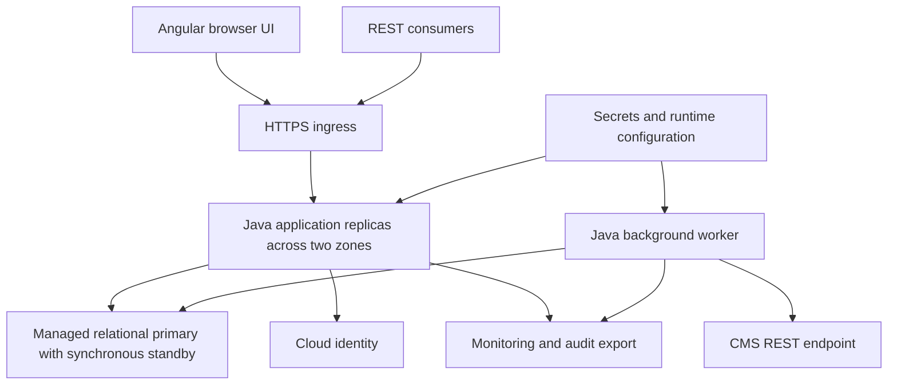

# Architecture Evaluation Result - Hotel Pricing System

## 1. Introduction

Fresh ATAM rerun started 2026-10-23 and resumed 2026-10-24, Asia/Seoul, and finalized on 2026-10-24 using the revised evaluation skill/template. This report completes Steps 1-9 with fresh stakeholder review and ballots, all 19 scenarios analyzed and per-scenario Trade-Off Maps. [Preparation](preparation.md) records method and baseline hashes. [Historical evaluation](history/2026-10-20/result.md) is retained separately; its votes are not current evidence. No ADD files or requirements are changed. No implementation, load, failover, security or integration test was run.

Replace legacy pricing for approximately 300 hotels, reduce revenue loss and support timely complete prices and reliable CMS delivery. HPS-2/3/4 and QA-1..5 are primary drivers. All 26 drivers remain in scope; two-month MVP and six-month delivery are constraints. Five simulated stakeholder roles are revenue/pricing, CMS integration, SRE operations, security/identity and engineering/QA. These are agents, not actual business approvals.

## 2. Architecture Presentation

### Step 4: Identified approaches

| Approach | Baseline decisions and location | Structures and interactions |
|---|---|---|
| AP1 Modular application and managed cloud | D1/D11; architecture 5/6 | Angular browser, Java API replicas, separate worker, HPS-owned relational storage; responsibility areas rather than assumed staffing |
| AP2 Identity and server authorization | D2; 7.1/7.5 | Cloud login, server sessions and current hotel/operation grants for every human/machine request |
| AP3 Bounded deterministic pricing | D3/D13; 7.2/7.3 | Pure versioned decimal calculator; exclusive hotel mutation lock; expected versions and idempotency receipts |
| AP4 Atomic publication and durable activation | D4/D14; 7.2/7.3 | PriceSet, publication, task and receipt share commit; one-date activation transactions with durable leases/progress |
| AP5 Authoritative snapshot queries | D5; 7.5 | Indexed primary reads, complete PriceSets and durable bounded-lived snapshot manifests |
| AP6 Recoverable REST delivery | D6; 7.4 | Transactional outbox, at-least-once sends, per-hotel order, receiver deduplication/sequence/durable receipt, blocked/redrive states |
| AP7 Durable measurement | D7; 7.4 | Unsampled publication/attempt ledger, export checkpoints and identity-set reconciliation |
| AP8 Availability/resource isolation | D8; 5/7.5 | Multi-zone API, synchronous standby, bounded pools, reserved query resources; primary remains shared bottleneck |
| AP9 Ports and adapters | D9; 6/7.6 | Protocol-neutral core and replaceable identity/CMS adapters; real disposable database in isolated tests |
| AP10 Promotion and replacement | D10/D12; 7.7/7.8 | Same artifact digests, runtime configuration, compatible migrations; reconciled legacy import and single authority switch |

The following is the **exact ADD section 5 container diagram**, reproduced without altered arrows or an invented evaluation topology. Arrows retain their original ADD interaction/dependency meaning; the diagram is not a fault tree or timing model. Per-scenario analysis links the corresponding unchanged ADD sequence.

## 3. Quality Attribute Utility Tree

### Step 5: Initial utility tree

Scores are fresh evaluator judgements using preparation anchors, not carried-over votes. Importance and Difficulty are 0..100 by tens; Sum is arithmetic addition. Original High/Medium priorities remain context. Every leaf is analyzed regardless of score. QA-8 difficulty reflects exact-timing gaps; QA-5 difficulty reflects key/session/revocation uncertainty. These judgements were reviewed by all five current stakeholder roles without requested score changes.

| Quality Attribute | Refinement | Scenario | Importance | Difficulty | Sum |
|---|---|---|---:|---:|---:|
| Performance | Complete publication <100 ms | QA-1 | 100 | 90 | 190 |
| Reliability | 100% accepted changes and CMS receipt | QA-2 | 100 | 100 | 200 |
| Availability | 99.9% query uptime outside maintenance | QA-3 | 100 | 80 | 180 |
| Scalability | 100k to 1m/day mean latency increase <=20% | QA-4 | 90 | 80 | 170 |
| Security | Validated identity and authorized functions | QA-5 | 100 | 70 | 170 |
| Modifiability | New protocol without core changes | QA-6 | 60 | 50 | 110 |
| Deployability | Environment movement without code changes | QA-7 | 60 | 50 | 110 |
| Monitorability | 100% publication performance/reliability measures | QA-8 | 80 | 90 | 170 |
| Testability | All elements independently integration-testable | QA-9 | 70 | 60 | 130 |

### Step 7: Fresh stakeholder pool and vote

The five role agents freshly reviewed the ten-candidate pool on 2026-10-23 and cast new public ballots on 2026-10-24. Each cast five distinct votes, total 25. They accepted the consolidation (ten distinct concerns), primary-attribute mappings and current initial scores without correction. [Participation](participation.md) records current ballots, reasons and cross-role exchanges. Prior ballots are not treated as fresh evidence. Rank is votes descending then numeric ID ascending; Importance/Difficulty sums do not determine selection.

| ID | Scenario | Quality Attributes | Votes |
|---|---|---|---:|
| S-02 | Irreparable policy activation recovery | Reliability | 4 |
| S-03 | Lost CMS receipt and late delivery | Reliability | 4 |
| S-04 | Legacy authority fencing | Reliability | 4 |
| S-05 | Query growth with hot-hotel mutations | Scalability | 4 |
| S-06 | DB failure under retention pressure | Availability | 3 |
| S-08 | Known-key rotation during IdP outage | Security | 2 |
| S-09 | Alternative query protocol and independent tests | Modifiability | 2 |
| S-07 | Revocation across cursors/replays | Security | 1 |
| S-10 | Release and rollback after accepted writes | Deployability | 1 |
| S-01 | Stale preview and durable replay | Reliability | 0 |

The selected new leaves are **S-02, S-03, S-04, S-05 and S-06**. S-02..05 tie at four votes and are ordered numerically; S-06 receives three. All ten scenarios are analyzed, including zero-vote S-01. Selection is unchanged from the archive, but current counts and reasons are independently collected; this is not evidence of risk closure. The table's Quality Attributes column deliberately names only the primary branch; related effects are documented separately in each analysis.

### Final utility tree and score prioritization

Exactly 14 leaves comprise nine original scenarios and the five vote winners. Primary attributes below exactly match the corresponding analysis. Scores use the same anchors and are evaluator judgements, not measured probabilities or person-days. Initial scores remain unchanged after current role review. New S-02/03/04 score 100/100 because critical reliability depends on unresolved exceptional-policy/receiver/authority contracts; S-05 scores 90/90 for skewed shared-primary capacity; S-06 scores 100/90 for service-dependent recovery under retention pressure. Sum is Importance + Difficulty, shown in descending score order with numeric IDs breaking ties within original/new groups; this does not override vote ranking.

| Quality Attribute | Refinement | Scenario | Importance | Difficulty | Sum |
|---|---|---|---:|---:|---:|
| Reliability | Complete publication and CMS receipt | QA-2 | 100 | 100 | 200 |
| Reliability | Exceptional activation recovery | S-02 | 100 | 100 | 200 |
| Reliability | Durable receipt under ambiguity | S-03 | 100 | 100 | 200 |
| Reliability | Cross-generation producer authority | S-04 | 100 | 100 | 200 |
| Performance | Complete publication latency | QA-1 | 100 | 90 | 190 |
| Availability | DB recovery with retention pressure | S-06 | 100 | 90 | 190 |
| Availability | Query continuity | QA-3 | 100 | 80 | 180 |
| Scalability | Hot-hotel mixed workload | S-05 | 90 | 90 | 180 |
| Scalability | Tenfold read volume | QA-4 | 90 | 80 | 170 |
| Security | Valid identity and current scopes | QA-5 | 100 | 70 | 170 |
| Monitorability | Complete publication measures | QA-8 | 80 | 90 | 170 |
| Testability | Independent element integration tests | QA-9 | 70 | 60 | 130 |
| Modifiability | Additional query transport | QA-6 | 60 | 50 | 110 |
| Deployability | No-code-change environment movement | QA-7 | 60 | 50 | 110 |

## 4. Architectural Approaches Analysis

### Step 6: Initial scenarios

Classification uses the revised skill. Each Primary Attribute is identical to the utility tree. Related effects retain existing QA names/IDs; functional invariants are not silently promoted to quality attributes. R/S/T/N IDs are defined in section 5. Structural evidence is causal design reasoning, not measurement.

### QA-1 — Local publication latency

#### Architectural Approach Analysis

| Scenario | QA-1 |
|---|---|
| Primary Attribute | Performance |
| Related quality effects | Reliability QA-2; Monitorability QA-8 |
| Functional invariants | Complete hotel/date PriceSet; approved monetary rules |
| Environment | Normal mixed workload; maximum supported room/rate dimensions and normal load undefined, A1 |
| Stimulus | Authorized user changes one hotel's base rate for one date |
| Response | Recalculate all dependent rates/rooms and atomically expose complete PriceSets |
| Response measure | Strict <100 ms; proposed ingress-to-commit clock requires agreement; 90 ms internal ceiling is an allocation only |
| Reasoning | Pure bounded computation and local commit avoid CMS latency, but exclusive hotel lock queues all mutations, including other dates and activation; synchronous storage adds latency |
| Evidence / assumptions | Architecture 7.3; validation QA-1 experiment not run. A1/A6 pending; reject-based apparent speedup is not success |
| Architecture diagram | Architecture 7.3 simulation/publication sequence and section 6 application diagram |

| Architectural Decisions | Risk | Sensitivity | Tradeoff | Non-risk |
|---|---|---|---|---|
| D3/D4/D8/D13 | R1: load/dimension/lock timing; R4: selected durability guarantee | S1/S2 | T1/T2 | N1: retain atomic local price/task/receipt commit |

#### Trade-Off Map

| Trade-Off | Option A leans toward | Option B leans toward |
|---|---|---|
| T1: Synchronous replication: Reliability QA-2 vs Performance QA-1 | A - D8 synchronous standby: Reliability increases because commit acknowledgement waits for a durable replica under the selected service contract; Performance decreases because the extra replication acknowledgement is on the commit path | B - asynchronous replication: Performance can improve by removing remote acknowledgement wait; Reliability decreases because acknowledged records can be absent at failover. Rejected as a silent durability relaxation; actual service guarantees remain A4 |
| T2: Unsampled durable ledger: Monitorability QA-8 vs Performance QA-1 | A - D7 retain unsampled accepted-publication evidence with D4 commit: Monitorability increases because each accepted publication has durable identity/outcome evidence; Performance decreases through added transaction writes/logging on the publication path | B - sampled or asynchronous volatile-only evidence: Performance can improve by removing hot-path writes; Monitorability decreases because unsampled/crash-window records can be missing. Not a compliant replacement for QA-8 |

### QA-2 — Complete publication and CMS receipt

#### Architectural Approach Analysis

| Scenario | QA-2 |
|---|---|
| Primary Attribute | Reliability |
| Related quality effects | Performance QA-1; Monitorability QA-8 |
| Functional invariants | No duplicate logical CMS effect or stale overwrite |
| Environment | Multiple edits, crashes, lost acknowledgements and recoverable CMS outage |
| Stimulus | User performs successive hotel price changes |
| Response | Every accepted change remains queryable and receives a durable CMS receipt without duplicate logical application or stale overwrite |
| Response measure | Original 100% requirement; accepted=committed/eventual receipt are A2 proposals; outage duration and recovery deadline unspecified |
| Reasoning | Atomic outbox removes local dual-write gap. Expiring claims and ID replay recover sender crashes; only receiver deduplication/order/receipt handles late requests and unknown outcomes. Finite storage and blocked hotel order limit progress |
| Evidence / assumptions | Architecture 7.3/7.4/7.8; A2/A3/A10/A13 unresolved; no CMS contract or fault results |
| Architecture diagram | Architecture 7.4 delivery and 7.8 cutover sequences |

| Architectural Decisions | Risk | Sensitivity | Tradeoff | Non-risk |
|---|---|---|---|---|
| D4/D6/D8/D12 | R2/R3/R10: receiver, replay retention and authority transition | S2/S3 | T1 | N1: retain local atomic outbox; external guarantees remain open |

#### Trade-Off Map

| Trade-Off | Option A leans toward | Option B leans toward |
|---|---|---|
| T1: Synchronous replication: Reliability QA-2 vs Performance QA-1 | A - D8 synchronous standby: Reliability increases because commit acknowledgement waits for a durable replica under the selected service contract; Performance decreases because the extra replication acknowledgement is on the commit path | B - asynchronous replication: Performance can improve by removing remote acknowledgement wait; Reliability decreases because acknowledged records can be absent at failover. Rejected as a silent durability relaxation; actual service guarantees remain A4 |

### QA-3 — Query availability

#### Architectural Approach Analysis

| Scenario | QA-3 |
|---|---|
| Primary Attribute | Availability |
| Related quality effects | Security QA-5; Reliability QA-2 |
| Functional invariants | Authorized complete query results |
| Environment | Eligible service time, dependency/node/zone failure and overload |
| Stimulus | Client queries while a component fails |
| Response | Healthy replicas serve authorized complete prices; bounded failure/retry and recovery are visible |
| Response measure | 99.9% outside agreed maintenance; provisional 30 days allows 43.2 minutes, not an approved SLA period; RTO/RPO open |
| Reasoning | Multiple API zones remove a single API-node dependency, but database failover, identity login and shared primary exhaustion remain failure paths |
| Evidence / assumptions | Architecture 5/7.5; A4 unresolved; no selected provider durability guarantee or failover/restore measurements |
| Architecture diagram | Architecture 5 container and 7.5 query/failover sequences |

| Architectural Decisions | Risk | Sensitivity | Tradeoff | Non-risk |
|---|---|---|---|---|
| D2/D8 | R4/R5/R6: recovery, primary contention and trust policy | S4/S5/S6 | T3 | None established for provider-specific failover or trust-window choice |

#### Trade-Off Map

| Trade-Off | Option A leans toward | Option B leans toward |
|---|---|---|
| T3: Cached identity trust: Availability QA-3 vs Security QA-5 | A - longer bounded previously verified signing-key trust during IdP outage: Availability increases for verified cached identities; Security decreases because compromised-key invalidation may be delayed | B - short trust window/revalidation: Security increases by shortening stale trust exposure; Availability decreases when revalidation cannot complete during provider outage. Unknown keys fail closed in both options, token/session expiry is never extended or bypassed, and longer key trust does not authorize longer token life |

### QA-4 — Read scaling

#### Architectural Approach Analysis

| Scenario | QA-4 |
|---|---|
| Primary Attribute | Scalability |
| Related quality effects | Availability QA-3; Performance QA-1 |
| Functional invariants | Complete and stable pagination |
| Environment | Same query/data mix at 100k and 1m daily requests, plus agreed peaks |
| Stimulus | API demand increases tenfold |
| Response | Sustain achieved traffic while bounding mean latency increase |
| Response measure | Mean high-load latency <=1.2 times baseline; report errors/throughput and tail latency together |
| Reasoning | Indexed bounded reads and API scaling help, but primary entitlement reads, snapshots, publication writes and worker polling share resources. 116 queries/s is provisional sizing, not a demand ceiling |
| Evidence / assumptions | Architecture 7.5; A5/A13 unresolved; no load profile or capacity evidence |
| Architecture diagram | Architecture 5 and 7.5 |

| Architectural Decisions | Risk | Sensitivity | Tradeoff | Non-risk |
|---|---|---|---|---|
| D5/D8/D13 | R5/R3: DB saturation and retention | S4 | None | None: indexes/reservations require sizing; preserve them provisionally |

#### Trade-Off Map

| Trade-Off | Option A leans toward | Option B leans toward |
|---|---|---|
| None established | A - retain bounded indexed primary reads and durable version manifests: supports the required current complete query response; exposes capacity/retention risks R3/R5 | B - introduce asynchronous read replicas or caches: may add read capacity but changes freshness semantics, which are functional query invariants here, not a separately established opposite QA effect. Requires a new freshness decision; no formal tradeoff asserted |

### QA-5 — Identity and authorization

#### Architectural Approach Analysis

| Scenario | QA-5 |
|---|---|
| Primary Attribute | Security |
| Related quality effects | Availability QA-3 |
| Functional invariants | Hotel/operation scope enforced at every public interface |
| Environment | Browser login and human/machine protected requests, including concurrent permission changes |
| Stimulus | User logs in and attempts scoped functions |
| Response | Provider validates identity; server permits only current hotel/operation grants and scopes administrative changes |
| Response measure | No unauthorized operation or hotel disclosure; explicit 401/403; post-commit authorization sees revocation, while already-authorized work may finish under A7 |
| Reasoning | Current server grants avoid UI-only enforcement; session/CSRF and identity validation are specified. In-flight boundary and privileged recovery permissions still need agreement |
| Evidence / assumptions | Architecture 7.1/7.5/8; A7 pending; negative/token/revocation tests not run |
| Architecture diagram | Architecture 7.1 login and 7.5 query sequences |

| Architectural Decisions | Risk | Sensitivity | Tradeoff | Non-risk |
|---|---|---|---|---|
| D2 | R6: in-flight/key/admin boundaries | S5/S6 | T3 | N2: retain server-owned current authorization across every public interface |

#### Trade-Off Map

| Trade-Off | Option A leans toward | Option B leans toward |
|---|---|---|
| T3: Cached identity trust: Availability QA-3 vs Security QA-5 | A - longer bounded previously verified signing-key trust during IdP outage: Availability increases for verified cached identities; Security decreases because compromised-key invalidation may be delayed | B - short trust window/revalidation: Security increases by shortening stale trust exposure; Availability decreases when revalidation cannot complete during provider outage. Unknown keys fail closed in both options, token/session expiry is never extended or bypassed, and longer key trust does not authorize longer token life |

### QA-6 — New query protocol

#### Architectural Approach Analysis

| Scenario | QA-6 |
|---|---|
| Primary Attribute | Modifiability |
| Related quality effects | Security QA-5; Testability QA-9 |
| Functional invariants | Transport parity of amounts, versions and errors |
| Environment | Existing REST query service, development change |
| Stimulus | Add a non-REST query endpoint |
| Response | Add transport mapping and composition wiring while preserving query/auth semantics |
| Response measure | Core source unchanged; equivalent validation, scope and snapshot results |
| Reasoning | Protocol-neutral ports separate transports; only a concrete second adapter can expose accidental coupling |
| Evidence / assumptions | Architecture 6/7.6; no implementation or alternative-adapter diff exists |
| Architecture diagram | Architecture 6 component and 7.6 extension sequence |

| Architectural Decisions | Risk | Sensitivity | Tradeoff | Non-risk |
|---|---|---|---|---|
| D9 | R7: accidental coupling and contract drift | S7 | None | N3: retain protocol-neutral principal-aware application ports |

#### Trade-Off Map

| Trade-Off | Option A leans toward | Option B leans toward |
|---|---|---|
| None established | A - protocol-neutral application ports with thin adapters: improves QA-6 extension and QA-9 isolation together | B - transport-specific core types: fewer initial mappings but risks core edits and harness coupling. Mapping effort is not another named QA; no opposite-direction tradeoff established |

### QA-7 — Environment promotion

#### Architectural Approach Analysis

| Scenario | QA-7 |
|---|---|
| Primary Attribute | Deployability |
| Related quality effects | Availability QA-3; Reliability QA-2 |
| Functional invariants | Artifact identity and schema overlap |
| Environment | Integration-to-staging promotion with external endpoints/secrets differing |
| Stimulus | Move application to another nonproduction environment |
| Response | Promote identical UI/backend artifacts with validated runtime configuration |
| Response measure | Same digests and no source modification; migrations preserve declared overlap/rollback window |
| Reasoning | Runtime Angular configuration addresses common build-time coupling; schema compatibility remains a separate release responsibility |
| Evidence / assumptions | Architecture 7.7; no pipeline promotion, config validation or rollback execution |
| Architecture diagram | Architecture 7.7 environment sequence |

| Architectural Decisions | Risk | Sensitivity | Tradeoff | Non-risk |
|---|---|---|---|---|
| D10 | R8: configuration/schema compatibility | S8 | None | N4: retain immutable artifacts plus runtime environment configuration |

#### Trade-Off Map

| Trade-Off | Option A leans toward | Option B leans toward |
|---|---|---|
| None established | A - identical artifacts plus runtime configuration and compatible schema overlap: directly supports QA-7 environment movement | B - environment rebuilds and simultaneous breaking schema replacement: may reduce configuration/overlap work but threatens the requirement. Effort is not a second quality, and no measured QA-6 burden establishes a formal tradeoff |

### QA-8 — Complete measurements

#### Architectural Approach Analysis

| Scenario | QA-8 |
|---|---|
| Primary Attribute | Monitorability |
| Related quality effects | Performance QA-1; Reliability QA-2 |
| Functional invariants | Unknown timings explicitly labeled; no fabricated measurement |
| Environment | Publication and retry activity during exporter/API crashes |
| Stimulus | Operator requests publication performance and reliability measures |
| Response | Export all durable identities/outcomes and label unknown timing rather than fabricate it |
| Response measure | Original 100% measure availability; identity completeness does not establish 100% exact latency completeness |
| Reasoning | Ledger/checkpoints recover exporter outages. Commit then crash before timing persistence can leave accepted publication without exact elapsed time; pre-persistence failures have a separate unproven accounting path |
| Evidence / assumptions | Architecture 7.4; A8/A13 unresolved; no completeness reconciliation results |
| Architecture diagram | Architecture 6 worker and 7.4 delivery/measurement sequence |

| Architectural Decisions | Risk | Sensitivity | Tradeoff | Non-risk |
|---|---|---|---|---|
| D7/D4 | R9/R3: exact timing, ingress scope and retention | S9 | T2 | None: full QA-8 collection remains incomplete |

#### Trade-Off Map

| Trade-Off | Option A leans toward | Option B leans toward |
|---|---|---|
| T2: Unsampled durable ledger: Monitorability QA-8 vs Performance QA-1 | A - D7 retain unsampled accepted-publication evidence with D4 commit: Monitorability increases because each accepted publication has durable identity/outcome evidence; Performance decreases through added transaction writes/logging on the publication path | B - sampled or asynchronous volatile-only evidence: Performance can improve by removing hot-path writes; Monitorability decreases because unsampled/crash-window records can be missing. Not a compliant replacement for QA-8 |

### QA-9 — Independent integration tests

#### Architectural Approach Analysis

| Scenario | QA-9 |
|---|---|
| Primary Attribute | Testability |
| Related quality effects | Modifiability QA-6; Security QA-5 |
| Functional invariants | Real storage semantics and complete element inventory |
| Environment | Integration harness without live CMS/identity/enterprise business systems |
| Stimulus | Test each system element and its integration behavior |
| Response | Substitute external adapters; use real disposable storage for transactional/locking semantics |
| Response measure | Every element in validation inventory independently testable; actual external staging checks additionally detect double drift |
| Reasoning | Inventory covers UI, core, worker, infrastructure and migration. Mocks alone cannot prove partner behavior or selected cloud durability |
| Evidence / assumptions | Architecture 7.6; validation inventory; A11 pending; harnesses not implemented/run |
| Architecture diagram | Architecture 7.6 testing sequence |

| Architectural Decisions | Risk | Sensitivity | Tradeoff | Non-risk |
|---|---|---|---|---|
| D9 | R7/R11: semantic fidelity and effort capacity | S10 | None | N3: retain replaceable external adapters; not a claim of executed coverage |

#### Trade-Off Map

| Trade-Off | Option A leans toward | Option B leans toward |
|---|---|---|
| None established | A - programmable external doubles with real disposable storage: supports QA-9 independence without mocking transaction semantics | B - live external systems for every integration test: improves immediate partner realism but violates independent execution. Fidelity is evidence quality, not a separately named opposite system QA here; partner staging checks complement A |

### Step 8: Fresh Phase 2 analysis

The current [scenario pool](scenario-pool.md) was freshly reviewed by five role agents on 2026-10-23. Stable IDs preserve comparison, not historical votes. Each candidate below has one primary attribute matching its pool label and any selected utility-tree leaf. Proposed stress/recovery values remain unapproved. All ten are analyzed regardless of their final vote counts.

### S-01 — Stale preview and lost-response replay

#### Architectural Approach Analysis

| Scenario | S-01, SH1 use case |
|---|---|
| Primary Attribute | Reliability |
| Related quality effects | Performance QA-1; current authorization is an existing QA-5 prerequisite |
| Functional invariants / constraints | HPS-2/4/5 monetary policy, complete PriceSets and one logical publication per command |
| Environment | Normal load with overlapping policy activation |
| Stimulus | Preview, activate different policy, submit stale version, refresh/commit and retry after lost response |
| Response | Reject stale new command; fresh calculation uses approved policy; authorized replay returns original durable result |
| Response measure | Zero stale commits/incomplete sets, one logical publication per key, A6 golden amounts; QA-1 only under agreed A1 |
| Reasoning | Expected versions, pure calculation, immutable receipt and atomic commit fit this sequence; no monetary policy or replay-expiry implementation is evidenced |
| Evidence / assumptions | Architecture 7.2/7.3/8; A1/A2/A6/A12/A13 unresolved; no executable tests |
| Architecture diagram | Architecture 7.3; authorization boundary in section 6 |

| Architectural Decisions | Risk | Sensitivity | Tradeoff | Non-risk |
|---|---|---|---|---|
| D2/3/4/13/14 | R1/R3/R6/R12 | S1/S5 | None | N1/N2 |

#### Trade-Off Map

| Trade-Off | Option A leans toward | Option B leans toward |
|---|---|---|
| None established | Version checks and committed replay protect QA-2 response invariants | Removing checks to save work is not an evidenced alternative for the same required behavior; hotel lock timing remains S1/R1. No additional formal T is established |

Required action: domain owner approves monetary examples; engineering/QA proves stale-first-command versus committed replay behavior, including expired keys and revocation, before pricing acceptance. Architecture is conditionally adequate; golden policy and retention cannot be inferred from decimal representation.

### S-02 — Irreparable activation at scale

#### Architectural Approach Analysis

| Scenario | S-02, SH1 exploratory/growth |
|---|---|
| Primary Attribute | Reliability |
| Related quality effects | Monitorability QA-8; Availability QA-3 only if price queries actually fail |
| Functional invariants / constraints | HPS-4/5 compensated target, correct amounts, latest edits preserved; blocked administration is not a query outage |
| Environment | Proposed 300 hotels x 365 dates with concurrent sales |
| Stimulus | Immutable policy target becomes irreparable after partial publication |
| Response | Trace versions/progress, preserve latest edits and converge via approved compensation/replacement |
| Response measure | Zero false completion/invalid sets/overwritten edits; proposed alarm <=60 seconds and local/CMS convergence <=30 minutes after approval |
| Reasoning | Durable per-date progress survives crashes, but no authorized state transition escapes an unrecoverable target. Routine redrive is not compensation and another activation is blocked |
| Evidence / assumptions | Architecture 7.2/7.8; A6/A12, CMS and telemetry limits open; proposed time bound unmeasured |
| Architecture diagram | Architecture 7.2 activation sequence |

| Architectural Decisions | Risk | Sensitivity | Tradeoff | Non-risk |
|---|---|---|---|---|
| D3/4/6/13/14 | R12/R2/R3 | S1/S3 | None | N1 |

#### Trade-Off Map

| Trade-Off | Option A leans toward | Option B leans toward |
|---|---|---|
| None established | Retain durable bounded per-date activation; it preserves recoverability but has missing exceptional compensation policy | An unbounded atomic hotel recalculation changes work scope and risks latency, but no opposite named QA effect is established for the proposed recovery criteria. This is R12 design incompleteness, not a formal T |

Required action: domain/pricing owners define approval, compensating state transitions, published-price consequences and cross-date acceptability; designer revisits D14 then QA performs partial-failure/concurrent-edit tests. Baseline does not satisfy the requested exceptional recovery behavior yet. No 30-minute commitment is supportable.

### S-03 — Lost CMS receipts and late requests

#### Architectural Approach Analysis

| Scenario | S-03, SH2 use case |
|---|---|
| Primary Attribute | Reliability |
| Related quality effects | Monitorability QA-8 |
| Functional invariants / constraints | Publication order, deduplication and receipt identity |
| Environment | CMS receives N, acknowledgement lost, worker lease expires and late request arrives |
| Stimulus | Retry same publication while N+1 waits |
| Response | Recover durable receipt; no duplicate logical effect/stale overwrite; other hotels progress |
| Response measure | All accepted test IDs receipt-matched; zero loss/duplicate logical updates/stale overwrites; proposed drain <=5 minutes |
| Reasoning | Immutable IDs and receiver sequence checks directly address ambiguity; local lease fencing alone cannot cancel sent traffic. Strict order can stall one hotel |
| Evidence / assumptions | Architecture 7.4; A2/A3/A8/A13 open, receiver support not demonstrated |
| Architecture diagram | Architecture 7.4 delivery sequence |

| Architectural Decisions | Risk | Sensitivity | Tradeoff | Non-risk |
|---|---|---|---|---|
| D4/6/7/13 | R2/R3/R9 | S3/S9 | None | N1 |

#### Trade-Off Map

| Trade-Off | Option A leans toward | Option B leans toward |
|---|---|---|
| None established | Preserve receipt-confirmed ordered retry and no silent discard | Relaxing order can alter QA-2 safety/progress; both effects concern the same attribute. Worker concurrency versus query impact remains conditional on unapproved recovery bounds, not an established cross-attribute T |

Required action: CMS/integration owners implement or negotiate receiver capabilities and test duplicate, late, 202 and receipt-lookup paths before integration sign-off; measure arrival/drain rate before accepting five minutes. Conditional design fit only.

### S-04 — Legacy request fencing across authority changes

#### Architectural Approach Analysis

| Scenario | S-04, SH2 exploratory |
|---|---|
| Primary Attribute | Reliability |
| Related quality effects | Monitorability QA-8; Availability QA-3 only for actual query interruption |
| Functional invariants / constraints | One writer, mapped producer identities and no obsolete-authority overwrite |
| Environment | Legacy freeze, HPS writes and ambiguous legacy deliveries; different namespaces |
| Stimulus | Delayed legacy request arrives while rollback is requested |
| Response | Map outstanding identities/receipts, reject obsolete producer authority, block unresolved cutover and reverse-reconcile before rollback |
| Response measure | Zero unmapped obligations, stale overwrites, simultaneous writers or gate passes with unresolved differences |
| Reasoning | Single-authority routing and reconciliation are specified, but old in-flight network traffic requires receiver-recognized authority fencing; sequence numbers from unrelated namespaces are insufficient |
| Evidence / assumptions | Architecture 7.8; A3/A10 open; epoch/equivalent mechanism and legacy export contract absent |
| Architecture diagram | Architecture 7.8 cutover plus 7.4 delivery |

| Architectural Decisions | Risk | Sensitivity | Tradeoff | Non-risk |
|---|---|---|---|---|
| D6/7/12 | R10/R2 | S3 | None | None: obsolete-authority receiver fencing remains missing |

#### Trade-Off Map

| Trade-Off | Option A leans toward | Option B leans toward |
|---|---|---|
| None established | Require receiver-recognized authority fencing and reconciled transfer | Routing-only rollback is unsafe for the same QA-2 objective; freeze/coordination cost alone is not a second quality. Missing protocol is R10 |

Closure action: see linked risk register owner and gate; baseline evidence is structural only.

### S-05 — Query growth with hot-hotel mutation

#### Architectural Approach Analysis

| Scenario | S-05, SH3 growth |
|---|---|
| Primary Attribute | Scalability |
| Related quality effects | Performance QA-1; Availability QA-3; Monitorability QA-8 |
| Functional invariants / constraints | Complete prices; no success claimed by dropping traffic |
| Environment | 100k to 1m daily equivalents; proposed 30-minute tenfold-average peak and 50% mutations at one hotel |
| Stimulus | Query surge concurrent with edits/activation |
| Response | Protect queries, bound background work and expose queueing/errors/starvation |
| Response measure | QA-4 mean <=1.2 baseline; QA-1 under agreed normal conditions; proposed valid-query success >=99.9% and no growing queue during peak |
| Reasoning | Reserved pools reduce connection competition, but hot-hotel mutation serialization and DB CPU/I/O remain shared. Yielding workers can slow convergence indefinitely without a fairness/drain criterion |
| Evidence / assumptions | Architecture 7.3/7.5; A1/A4/A5/A12 unresolved; no mixed stress test |
| Architecture diagram | Architecture 5/7.3/7.5 |

| Architectural Decisions | Risk | Sensitivity | Tradeoff | Non-risk |
|---|---|---|---|---|
| D5/8/13/14 | R1/R5/R3 | S1/S4 | None | None: capacity/reservations require sizing |

#### Trade-Off Map

| Trade-Off | Option A leans toward | Option B leans toward |
|---|---|---|
| None established | Reserve query resources and bound background work under shared-primary load | More worker capacity can alter query/recovery behavior, but no agreed QA-2 deadline or measured capacity exists. Competing performance workloads alone are not two attributes; R1/R5 remain |

Performance/SRE owners must measure full offered/completed/error workload with bursts and fairness before capacity sign-off. No capacity conclusion follows from API replica count.

### S-06 — Failover under telemetry and retention pressure

#### Architectural Approach Analysis

| Scenario | S-06, SH3 exploratory |
|---|---|
| Primary Attribute | Availability |
| Related quality effects | Reliability QA-2; Monitorability QA-8; Performance QA-1 is a related effect of T1/T2, not the primary attribute |
| Functional invariants / constraints | No pending-task/live-snapshot pruning and no invented timing |
| Environment | Proposed 24-hour export outage, 70% starting storage and one DB-zone failure |
| Stimulus | Primary fails while records and snapshot references accumulate |
| Response | Restore queries/tasks and resume export without deleting pending obligations/live references; label unknown timing |
| Response measure | Proposed recovery <=60 seconds, committed-record RPO=0, alert <=1 minute at 80% storage and export drain <=4 hours; complete ID reconciliation |
| Reasoning | Standby/ledger/checkpoints are plausible mechanisms, but selected service durability, retention headroom and concurrent drain are unknown. Synchronous replication wording alone cannot prove all failure durability |
| Evidence / assumptions | Architecture 5/7.4/7.5/8; A4/A8/A13 unresolved; no failover/storage experiment |
| Architecture diagram | Architecture 5 container and 7.4/7.5 sequences |

| Architectural Decisions | Risk | Sensitivity | Tradeoff | Non-risk |
|---|---|---|---|---|
| D5/7/8 | R3/R4/R5/R9 | S2/S4/S9 | T1/T2 | None: provider-specific durability/recovery remains unresolved |

#### Trade-Off Map

| Trade-Off | Option A leans toward | Option B leans toward |
|---|---|---|
| T1: Synchronous replication: Reliability QA-2 vs Performance QA-1 | A - D8 synchronous standby: Reliability increases because commit acknowledgement waits for a durable replica under the selected service contract; Performance decreases because the extra replication acknowledgement is on the commit path | B - asynchronous replication: Performance can improve by removing remote acknowledgement wait; Reliability decreases because acknowledged records can be absent at failover. Rejected as a silent durability relaxation; actual service guarantees remain A4 |
| T2: Unsampled durable ledger: Monitorability QA-8 vs Performance QA-1 | A - D7 retain unsampled accepted-publication evidence with D4 commit: Monitorability increases because each accepted publication has durable identity/outcome evidence; Performance decreases through added transaction writes/logging on the publication path | B - sampled or asynchronous volatile-only evidence: Performance can improve by removing hot-path writes; Monitorability decreases because unsampled/crash-window records can be missing. Not a compliant replacement for QA-8 |

SRE/operations must choose storage guarantees, size outage/replay horizons and rehearse recovery with active workloads before accepting proposed RTO/RPO. Until then all proposed numbers remain unverified and QA-8 exact timing remains partial.

### S-07 — Revocation on cursor and receipt replay

#### Architectural Approach Analysis

| Scenario | S-07, SH4 use case |
|---|---|
| Primary Attribute | Security |
| Related quality effects | Performance QA-1 through grant lookup overhead; audit is evidence, not expanded QA-8 |
| Functional invariants / constraints | Hotel/operation scopes and current authorization before replay disclosure |
| Environment | Multiple replicas, human/machine grants revoked, some already-authorized in-flight requests |
| Stimulus | Reuse token/session/cursor/publication ID/idempotency key and substitute hotel ID |
| Response | Current grants precede disclosure/mutation on every post-revocation authorization; audit in-flight boundary |
| Response measure | Zero unauthorized exposure/change after a post-revocation check; zero bypass routes; no new attempt-count threshold in this run |
| Reasoning | Section 8's all-interface authorization and current page checks support this. Sequence 7.3 must not be misread as receipt replay preceding authorization; A7 explicitly allows already-authorized work to finish |
| Evidence / assumptions | Architecture 6/7.1/7.3/7.5/8; A7 open; no attack tests |
| Architecture diagram | Architecture 6 authorization boundary and 7.5 query |

| Architectural Decisions | Risk | Sensitivity | Tradeoff | Non-risk |
|---|---|---|---|---|
| D2/5 | R6 | S5 | None | N2 |

#### Trade-Off Map

| Trade-Off | Option A leans toward | Option B leans toward |
|---|---|---|
| None established | Check current grants on every replay, cursor and mutation | Cached grants are not a demonstrated availability improvement when prices and grants share the primary. Authorization is S5; implementation latency overhead alone does not establish a high-leverage opposing-QA tradeoff |

Security/engineering must enumerate every interface and prove current scope before replay/pagination result access, with authorization revision in evidence. A requirement to abort already-authorized commits would reopen D2; this evaluation does not silently impose it.

### S-08 — Key rotation and IdP outage

#### Architectural Approach Analysis

| Scenario | S-08, SH4 exploratory |
|---|---|
| Primary Attribute | Security |
| Related quality effects | Availability QA-3 |
| Functional invariants / constraints | Unknown keys and expired tokens rejected under both trust policies |
| Environment | Proposed 15-minute IdP/JWKS outage during rotation |
| Stimulus | Requests with cached valid and unknown signing keys |
| Response | Fail closed for unknown/unverified identities; enforce approved cached trust/expiry/current grants; bound refresh work and count failures |
| Response measure | Zero unverified access/expiry bypass; no new alert/recovery time in this run; trust and emergency invalidation remain open |
| Reasoning | Baseline specifies fail-closed unknown keys and continuing valid sessions, but maximum trust age, compromised-key emergency invalidation and cache refresh contention are undefined |
| Evidence / assumptions | Architecture 7.1/7.5; A4/A7 unresolved; no provider-outage or compromised-key test |
| Architecture diagram | Architecture 7.1 identity and 7.5 dependency flow |

| Architectural Decisions | Risk | Sensitivity | Tradeoff | Non-risk |
|---|---|---|---|---|
| D2/8/9 | R6/R4 | S6 | T3 | N2: authorization ownership only, not trust-window selection |

#### Trade-Off Map

| Trade-Off | Option A leans toward | Option B leans toward |
|---|---|---|
| T3: Cached identity trust: Availability QA-3 vs Security QA-5 | A - longer bounded previously verified signing-key trust during IdP outage: Availability increases for verified cached identities; Security decreases because compromised-key invalidation may be delayed | B - short trust window/revalidation: Security increases by shortening stale trust exposure; Availability decreases when revalidation cannot complete during provider outage. Unknown keys fail closed in both options, token/session expiry is never extended or bypassed, and longer key trust does not authorize longer token life |

Security/operations define maximum trust, emergency key invalidation and refresh limits; QA simulates rotation/outage/recovery and checks counted failures. Availability must not be improved by accepting an unverified key.

### S-09 — Alternative protocol with trustworthy tests

#### Architectural Approach Analysis

| Scenario | S-09, SH5 growth |
|---|---|
| Primary Attribute | Modifiability |
| Related quality effects | Testability QA-9; Security QA-5 |
| Functional invariants / constraints | Amounts, errors, versions and authorization semantics preserved |
| Environment | Integration with external doubles and production-equivalent real storage |
| Stimulus | Developer adds alternative price query transport |
| Response | Adapter/composition-only implementation preserves scopes, amounts, versions, pagination/errors and independent testability |
| Response measure | Zero core source changes; all test inventory elements independently exercisable; parity includes revocation/expiry |
| Reasoning | Ports and real-store harness plan support the goal; implementation boundary and double fidelity remain evidence gaps |
| Evidence / assumptions | Architecture 6/7.6; A7/A11/A13; no source diff or harness execution |
| Architecture diagram | Architecture 7.6 |

| Architectural Decisions | Risk | Sensitivity | Tradeoff | Non-risk |
|---|---|---|---|---|
| D9 | R7/R6 | S7/S10 | None | N3 |

#### Trade-Off Map

| Trade-Off | Option A leans toward | Option B leans toward |
|---|---|---|
| None established | Keep protocol-neutral core and real-store/external-double harnesses | Ports support QA-6 and QA-9 in the same direction. Mapping effort and mock maintenance are costs, not opposing quality attributes |

Engineering/QA must demonstrate unchanged-core diff, parity and complete harness coverage, then compare staging against partner contracts. This is design-supported, not implemented evidence.

### S-10 — Release and rollback after writes

#### Architectural Approach Analysis

| Scenario | S-10, SH5 use case/exploratory |
|---|---|
| Primary Attribute | Deployability |
| Related quality effects | Reliability QA-2; Testability QA-9; CON-4 is a delivery constraint |
| Functional invariants / constraints | Artifact identity, compatible schema and reconciled authority changes |
| Environment | Staging old/new binaries, schema overlap, legacy fixture and CMS double; two/six-month constraint |
| Stimulus | Defect after HPS accepts writes and CMS publications |
| Response | Distinguish same-schema binary rollback from legacy authority reversal; reconcile writes/receipts, block unsafe rollback and prepare forward recovery |
| Response measure | Same UI/backend digests, no environment code changes, zero overlapping writers, all accepted changes accounted; two/six months from agreed kickoff with actual capacity |
| Reasoning | Expand/contract preserves binary overlap but cannot reverse external financial effects. Single authority and conditional rollback are appropriate; resources and full reverse-reconciliation protocol are absent |
| Evidence / assumptions | Architecture 7.7/7.8, iteration-plan; A2/A3/A9/A10/A11 pending; no release rehearsal |
| Architecture diagram | Architecture 7.7 promotion and 7.8 cutover |

| Architectural Decisions | Risk | Sensitivity | Tradeoff | Non-risk |
|---|---|---|---|---|
| D10/11/12 | R8/R10/R11 | S8 | None | N4 |

#### Trade-Off Map

| Trade-Off | Option A leans toward | Option B leans toward |
|---|---|---|
| None established | Promote immutable artifacts and preserve declared schema overlap | Rollback coordination/implementation effort and CON-4 deadlines are constraints, not demonstrated opposing named QA effects. External-state reversal remains R10 |

Engineering/product/platform/CMS owners must staff and estimate the minimum scope, secure partner access and rehearse binary rollback separately from authority rollback. Architecture buildability is undetermined; no extra microservice/platform work is recommended without an identified requirement.

### Step 8 revalidation of all nine initial scenarios

| Initial scenario / primary attribute | Current candidate challenge and disposition |
|---|---|
| QA-1 / Performance | S-01/S-05 expose policy overlap and hotel-lock waits; R1 remains. T1/T2 concern commit/telemetry cost, not an invented throughput versus simplicity attribute |
| QA-2 / Reliability | S-01..04/S-06/S-10 require receiver guarantees, expired replay policy, permanent activation compensation and authority mapping. R2/R3/R10/R12 remain; ordering/HOL is not automatically a cross-QA tradeoff |
| QA-3 / Availability | S-06/S-08 address DB failure and valid-identity trust. R4/R5/R6 remain. Blocked configuration or write freeze alone is not query unavailability |
| QA-4 / Scalability | S-05 mixed load and S-06 retention pressure expose shared primary. R5 remains; resource competition is not automatically two opposing attributes |
| QA-5 / Security | S-07/S-08/S-09 challenge replay, key trust and protocol parity. N2 remains sound responsibility; R6 remains for policy/implementation. T3 concerns known-key trust only |
| QA-6 / Modifiability | S-09 requires unchanged core and parity evidence. N3 retained; R7 remains. QA-6/9 improve together, so not a formal tradeoff |
| QA-7 / Deployability | S-10 distinguishes binary and authority rollback. N4 retained; R8/R10 remain. Migration effort and schedule constraints are not additional QA branches |
| QA-8 / Monitorability | S-02/03/04/05/06 expose publication progress/reconciliation. R9 remains; unrelated security audit is supporting evidence, not automatic expansion of QA-8. T2 does not solve exact timing |
| QA-9 / Testability | S-09/S-10 require complete independent harness and real partner comparison. N3 retained; R7/R11 remain. No runtime proof or effort-based opposing-QA tradeoff |

## 5. Summary

### Consolidated risk register

| ID | Finding and consequence | Decisions / assumptions | Owner and required closure evidence |
|---|---|---|---|
| R1 | Hotel serialization, dimensions and synchronous commit can violate strict publication latency | D3/4/13; A1 | Performance/pricing leads: agree load/dimensions and benchmark all elapsed time, contention and errors |
| R2 | Unconfirmed CMS receipt/dedup/order means end-to-end QA-2 is unproved | D6; A2/A3 | Integration/CMS owners: signed behavior contract and crash/late-send/202 reconciliation tests |
| R3 | Finite backlog, replay/cursor retention and admission can exhaust shared storage or invalidate recovery | D5/6/7; A2/A8/A13 | SRE/integration: horizon/capacity policy, replay expiry behavior and outage/drain tests |
| R4 | SLA exclusions, durability and recovery targets undefined; standby is not a zero-loss proof | D8; A4 | Operations/product: SLA/RTO/RPO and selected-provider failover/restore evidence |
| R5 | Primary saturation couples query/write/worker workloads despite process separation | D5/8/13; A1/A5 | Performance/SRE: mixed/skewed load with DB saturation and reserved resource evidence |
| R6 | In-flight revocation/admin/machine/recovery authority still conditional | D2; A7 | Security/product: explicit boundaries, least-privilege matrix and negative/concurrent tests |
| R7 | Ports and doubles may drift from real contracts and new adapter security | D9; A11 | Engineering/QA: core unchanged adapter demo and versioned partner contract checks |
| R8 | Incompatible schema/runtime configuration defeats promotion/rollback | D10 | Platform/QA: same-digest promotion and old/new binary migration rollback rehearsal |
| R9 | Durable IDs cannot guarantee exact crash-window timing or all ingress measures | D7; A8 | Operations/product: define measure inventory, prove completeness or explicitly revise/retain unmet target |
| R10 | Legacy export/backlog/rollback agreement incomplete; potential conflicting or lost prices | D12; A10 | Migration/CMS: full reconciliation and watermark/reverse-reconciliation rehearsal |
| R11 | Team, budget, provider and scope unknown: two/six-month buildability is undetermined | D1/11; A9 | Engineering/product: named capacity, estimates, dependency access and approved scope |
| R12 | Cross-date policy differences and immutable unrecoverable activation can leave hotel blocked indefinitely | D3/14; A6/A12 | Domain/pricing: explicit monetary policy, cross-date acceptance and exceptional compensation state machine before activation acceptance |

R12 is a functional integrity/operability finding from architecture 7.2/7.8, even though it is not a separate initial QA leaf. Its evaluation must not disappear because the nine initial QA scenarios omit explicit activation recovery.

Historical designer concerns from 2026-10-19 were rechecked against the unchanged source during this rerun; they are not presented as fresh stakeholder votes: R3 includes a replay after idempotency receipt/receiver deduplication expiry, which can reapply a command unless horizons and expired-key rejection/tombstone/archive lookup are coordinated. R6 includes cached signing-key maximum trust age and emergency compromised-key invalidation, currently unspecified. Idempotent replay must authorize before returning an old receipt: architecture section 8 requires current grants on every public interface; section 7.3's replay precedence concerns stale version checks, not permission checks. Its abbreviated diagram is an implementation traceability hazard, not evidence that bypass is intended. R10 includes legacy/new producer epoch and namespace mapping against late old requests; general watermark language is not a complete receiver fencing protocol. R5 includes DB CPU/I/O/WAL/checkpoint/storage contention: separate connection pools alone do not isolate these resources.

### Sensitivity register - decision and one high-leverage attribute

| ID | Decision/parameter | Named quality and structural leverage |
|---|---|---|
| S1 | D13 exclusive hotel mutation lock | Performance QA-1: hold time and arrival skew directly govern queue wait on publication |
| S2 | D8 replication acknowledgement policy | Reliability QA-2: whether accepted records survive primary failure depends on acknowledgement/durability boundary |
| S3 | D6 receiver receipt/deduplication/sequence contract | Reliability QA-2: absent receiver support, late/repeated sends can lose the end-to-end guarantee |
| S4 | D5/D8 primary query workload and reservations | Scalability QA-4: CPU/I/O/query mix and bounded capacity determine latency at tenfold load |
| S5 | D2 current grant-check policy | Security QA-5: check point determines which revoked scopes may still act |
| S6 | D2 maximum known-key trust lifetime | Security QA-5: maximum trust of previously verified signing keys controls compromise exposure window; token/session expiry remains a separate fixed bound |
| S7 | D9 protocol-neutral application boundary | Modifiability QA-6: transport leakage forces core changes for an additional protocol |
| S8 | D10 runtime configuration/artifact identity | Deployability QA-7: environment-specific compilation would violate no-code-change promotion |
| S9 | D7 unsampled durable ledger policy | Monitorability QA-8: persistence/sampling determines recoverable publication evidence coverage |
| S10 | D9 real-store and replaceable-external harness design | Testability QA-9: doubles and real transaction semantics determine independent coverage |

A formal tradeoff below has two explicit sensitivity effects; the register's one-attribute entries are starting points, not assertions that decisions affect only one quality.

### Formal tradeoff register

| ID | Decision | First sensitivity | Opposite sensitivity | Evidence/limit |
|---|---|---|---|---|
| T1 | D8 synchronous vs asynchronous replication acknowledgement | Reliability QA-2 rises with synchronous durable-copy acceptance | Performance QA-1 worsens with extra acknowledgement wait on commit | Architecture 5/7.3/7.5; service-specific magnitude/durability unproved |
| T2 | D7 durable unsampled accepted-publication evidence vs reduced hot-path evidence | Monitorability QA-8 improves coverage/reconstruction | Performance QA-1 worsens through additional publication transaction writes | Architecture 7.3/7.4; no measured effect and exact timing still incomplete |
| T3 | D2 longer vs shorter maximum trust for previously verified signing keys | Availability QA-3 improves during provider outage with longer trust | Security QA-5 worsens through delayed compromised trust invalidation | Architecture 7.5; A7 window/emergency policy unresolved; unknown keys always fail closed and neither option extends token/session expiry |

Only these three are currently established as formal directional tradeoffs. Current-grant checks are a QA-5 sensitivity, not a formal QA-3 tradeoff here: grants and prices share the primary, so cached grants alone do not demonstrate query continuity during primary loss. Ordered delivery head-of-line delay is a QA-2 realization risk, not automatically a second quality. Snapshot retention cost is a resource concern. Protocol ports improve QA-6 and QA-9 together; implementation effort is not an opposite named quality. Deadline/scope is CON-4 and functional scope, not an invented QA. Compatible schema overlap has no demonstrated opposite QA-6 requirement here.

### Non-risk register - sound decisions requiring no architectural change in scope

| ID | Decision retained | Justification and boundary |
|---|---|---|
| N1 | D4 local atomic price/publication/task/receipt commit | Removes local dual-write inconsistency within one storage transaction; no architectural change to this boundary is needed. Does not establish remote receipt, failover durability or latency compliance |
| N2 | D2 server-owned authorization on every public interface | Prevents UI-only enforcement and places scope checks at authoritative boundary; retain this responsibility, while A7 key/revocation policy is unresolved |
| N3 | D9 protocol-neutral principal-aware ports and replaceable external adapters | Fits explicit QA-6/9 extension/isolation goals without duplicated transport business logic; retain boundary, while actual harness/parity evidence is absent |
| N4 | D10 immutable artifacts with runtime UI/backend configuration | Directly supports no-code-change environment movement; retain configuration strategy, while schema/secret correctness and promotion tests remain pending |

No other tactic is called a non-risk merely because its intended mechanism sounds plausible. Unresolved sizing, compensation, identity trust and provider contracts remain risks.

### Step 9: Present results

This fresh evaluation records ten approaches, a 14-leaf final utility tree, 25 current public votes, 19 scenario analyses with 19 Trade-Off Maps, twelve risk findings, ten sensitivity points, three formal opposite-direction quality tradeoffs, four scoped non-risks and five risk themes. Initial scenarios are explicitly revisited against the new candidates. Results are returned to the same five simulated roles; closing presentation is recorded by the facilitator in [participation](participation.md). This is document-level evaluation, not real stakeholder acceptance or runtime proof.

**Quality suitability is conditional and not established.** Retain the four justified decisions in the non-risk register. Resolve exceptional activation compensation (A12) and cross-generation receiver authority/receipt/replay policy (A2/A3/A10/A13), then execute the planned latency, capacity, fault, security and completeness experiments. Remaining gaps can prevent the resulting system from meeting its quality goals; no unconditional production readiness is asserted.

**Buildability remains undetermined:** actual staffing, scope, budget, provider and partner readiness are unknown. The gated actions below and capacity-backed plan are required before the two/six-month constraints can be substantiated. The report recommends targeted subsequent ADD refinement; it does not perform ADD again or change its baseline.

### Risk themes and closure gates

| Theme | Findings / scenarios | Business implication | Gate and accountable roles |
|---|---|---|---|
| RT1 Pricing and policy authority | R12/R6; S-01/02/07 | Incorrect tax/rule application or unrecoverable activation may impair sales and expose privileged operations | Before pricing/activation implementation acceptance: domain/product approve A6/A12; security approves who can compensate/redrive; designer specifies audited exceptional transitions; QA tests partial progress and concurrent edits |
| RT2 Cross-system and historical integrity | R2/R3/R10; S-03/04/10 | Local commit does not prove CMS receipt or safe legacy authority transfer | Before CMS integration/cutover: CMS/integration/migration owners settle A2/A3/A10/A13, shared producer namespace/epoch and expiry policy; execute late-request, backlog and reverse-reconciliation rehearsal |
| RT3 Shared-primary performance and continuity | R1/R4/R5; S-05/06/08 | Added replicas cannot remove lock queues, storage contention or dependency outages | Before quality sign-off: performance/SRE/product agree A1/A4/A5; select actual service guarantees and test hot-hotel mixed load, failure and restore with errors counted |
| RT4 Evidence and trust completeness | R6/R7/R9; S-06/07/08/09 | Missing exact timings, unsafe trust windows or drifting doubles can make compliance claims unreliable | Before security/monitorability/test acceptance: security/operations/QA settle A7/A8/A11; prove inventory/ID accounting, label unknown timings and demonstrate protocol/security parity |
| RT5 Delivery feasibility and reversible operations | R8/R11; S-09/10 | Two/six-month dates and rollback remain unsubstantiated without capacity and rehearsals | Before date/cost commitment and release: engineering/product/platform approve A9, named ownership/estimates and partner access; same-digest/schema overlap and business rollback rehearsals |

Gate priority is consequence-based, not a substitute for the stakeholder ranking. A high-risk unselected scenario remains a gate when it threatens original requirements. No risk is accepted on behalf of actual business owners. Actions are recommendations for subsequent implementation or ADD refinement, not changes made to the architecture during ATAM.

### Buildability assessment

D1's familiar Java/Angular stack, one modular application and separate worker avoid unnecessary distributed transaction and platform scope. D9/D10 provide credible extension/testing/deployment boundaries. However A9 leaves team size/skills allocation, budget, cloud provider, kickoff and MVP scope unknown; CMS receiver work, A12 compensation design, migration and the extensive evidence program can dominate the critical path. Consequently the second suitability criterion, buildability with available resources, is **undetermined**. A resource-backed work plan must include external contract lead times and early spikes for hotel-lock latency, CMS ambiguity and exceptional activation before a two-month MVP/six-month release commitment is defensible. This evaluation does not assume four separate teams merely because the ADD plan names four responsibility areas.

### Classification changes from the archived evaluation

The unchanged ADD baseline is reassessed with stricter definitions. The former twelve broad tradeoff labels are not retained as formal tradeoffs: only three structurally supported opposite-QA decisions remain in this report. Former labels about ordering/simplicity, head-of-line progress, freshness, retention cost, mapping effort, query/worker competition and deadline/scope are now identified as sensitivities, risks, functional invariants or constraints as appropriate. Four scoped non-risks remain; other plausible tactics are not called sound/no-change while their decisive contracts, policies or sizing are unresolved. This reclassification does not claim those concerns were fixed. No source architecture or requirement is rewritten.

